# Rhino 9 + Claude: sheds, a framing sheet and BOMs

Over two days, 9 and 10 November 2026, we worked with Claude inside Rhino 9 on a small building: a row of sheds, each holding one toilet, raised on piers and reached by a deck, with plumbing down to a septic pit. We gave a brief, then sent change requests. Claude wrote Python, ran it in Rhino, read back what Rhino reported and fixed what it found.

What came out:

- **Ten layouts, options A to J,** built over 13 runs.
- **Five sheets:** A-101, an exploded framing axonometric with two circular details, a framing key and a framing BOM table; and A-102 to A-105, an axon of each of the first four layouts.
- **Bills of materials (BOMs)** read from the model for 8 layouts, and material cost estimates for 6 of them.

This is the raw write-up: what we gave Claude, the workflow run by run, the options, the numbers, the outputs, what failed, and the lessons. It reports one working session, not a controlled evaluation. Nothing was built a second way, so there is no comparison arm.

## How to read this document

- Figures come from the session transcripts, the generator scripts, the BOM and cost files, the sheets and the images saved by the session. Those working files are not published, apart from the samples in this folder. Anything we could not check against them is marked **unverified**.
- A **row** (9 November) is one version of the model containing all four layouts A to D side by side. A **run** (10 November) is one new file with one new option. Rows 1 to 6 are runs 1 to 6.
- Times are UTC.
- Place, client and utility names are removed. The sheet title blocks have been re-set to a neutral title (see [Images](#10-images-in-this-folder)). Costs are given in US dollars, converted at the exchange rate each estimate recorded.
- "Opus" means `claude-opus-5-5`, the only model used in the Rhino panel on both days.

---

## 1. Setup

| | 9 November | 10 November |
|---|---|---|
| Where Claude ran | Rhino 9 AI panel (Claude Code 2.1.319 in SDK mode) | Same panel; plus separate Claude runs started by a coordinating agent for runs 12 and 13 |
| Model | `claude-opus-5-5`, all 333 responses | `claude-opus-5-5` in the panel |
| Rhino | 9.0.26300.9402 (recorded 4 November, not re-recorded) | Rhino 9; run 12 was built by a separate run in a Rhino 8 window (see run 12) |
| Rhino tools | McNeel's Rhino MCP platform 0.3.0: 45 `mcp__rhino__*` tools plus `advisor` | Same tool set |
| Arch Studio | A local test build of the Arch Studio Rhino skills (`rhino`, `rhino-setup`, version 0.7.0) and its checker script, `as-check.py` | A newer pre-release build: `rhino-model` and `rhino-bom`, whose checker adds clash, pipe-network and hardware checks and a "not checked" list to its status line |
| Arch Studio MCP | Not in the tool list; no calls | Not used |

Neither day used Rhino commands to build. The 9 November skill said "Never build through `run_command`"; Claude made 272 `run_python` calls and 0 `run_command` calls that day. On 10 November the panel made 5 `run_command` calls, none of them to build geometry: one to open a file and four to zoom or set a view.

## 2. Inputs

### 2.1 The brief

The first message, verbatim except for one utility name:

> start a new file and let's model a 4 unit toilet building. they should be in a modular configuration of cubes where proporitions are managed by the cube size. roofs should be buildable out of wood and thatch. this can be either in 2x framing or we can use glt beams if needed. it should be lifted off the ground accessible via a deck. have the agent ask me any other questions needed to successfully complete the modeling exercise. [...] plumbing should be modeled and it should go to a [septic pit]. water can come from [the national utility].

Claude asked 15 questions in one `ask_user` call and four more after writing the first requirements. The answers that shaped the design:

| Question | Answer |
|---|---|
| Use and load | Public or park use, about 100 people a day (sizes the septic pit) |
| Cube size, inside | 2.40 m |
| Arrangement | "Do all 4 options" |
| Contents | Toilets inside; shared basins outside on the deck |
| Accessibility | 2 + 2 standard units plus a fifth, accessible, all-gender unit, in every layout |
| Accessibility values | US ADA values as stand-ins, flagged to be checked against the national standard |
| Floor and access | 0.60 m, ramp and steps |
| Roof | A separate pyramid roof per cube; 2x rafters, glulam (GLT) only where a span needs it |
| Walls and floor | 2x6 frame, vertical board cladding, wood floor framing on concrete piers |
| Water and waste | Direct supply from the meter; pipes as solids at real diameters; inspection chamber and septic pit; truck access |
| Control | A Grasshopper definition with a cube-size slider |

Eleven of the 15 answers were the option Claude had marked as recommended.

### 2.2 Framing standards

For row 6 we wrote "review US framing standards and update model accordingly with a row 6 that would frame out according to best practices", with a link to a PDF on awc.org.

| Source | What Claude did with it |
|---|---|
| The linked PDF | It was the **errata** to the 2024 Wood Frame Construction Manual (WFCM), 8 pages, not the manual. Claude read it and said none of the corrections governed the model's curved GLT ribs. |
| WFCM chapters | The chapter PDF it fetched was encrypted and view-only. Claude said so and did not try to bypass it. **Not read.** |
| AWC *Details for Conventional Wood Frame Construction* (WCD1) | Downloaded as CAD archives. Claude read the **figure labels** in 73 DXF files: earth-to-framing clearances, pier anchor bolts, double headers and cripple studs at openings, wood deck. Labels only, not drawings. |
| General US practice | Studs and joists at 16 in. centres, lapped double top plates, GLT ribs at 24 in. maximum with uplift ties, grab-bar backing. Labelled "general US practice, to be verified" in every report. |
| ADA 2010 | Toilet seat and grab-bar values, used as stand-ins. |
| Local code | Not read on 9 November. On 10 November Claude read the local building code online for toilet-room minimums (run 10). |

Nothing was engineered. Claude's own row 6 report: "a structural engineer still needs to size it for [the site's] wind and public use."

### 2.3 Skills used

**9 November.** Claude read the skill's `SKILL.md`, `references/elements.md`, `references/grasshopper.md` and part of the checker at the start, then followed its order: questions, requirements written into the document before any geometry, build by script, check. The checker (ASCheck) prints a line such as `ASCHECK status=pass checks=391/391`. The Rhino `ASCheck` command printed only "Done.", so Claude ran the script directly from `run_python`. The transcript has 44 status lines: 37 pass, 7 fail.

Asked "were they useful?", Claude answered: "Somewhat: the process helped, but the checker gave much less assurance than '267/267' suggests. I can't say how much the skill added overall, because I didn't build the same model without it." It rated asking questions first as "most useful" and ASCheck as proof of quality as "weak", since it had no clash or connectivity test.

**10 November.** The panel loaded the newer skills through a startup hook. Status lines now read, for example, `Requirements: 67/67 checks met - 18 not measured - not checked: structure, code compliance - no code applied - 2 revisions written after geometry existed - 3 count ranges too wide`. For option H the test copy of the checker had gone from disk, so Claude ran a local copy; it returned the same 69/69 on option G's requirements before being used on H.

### 2.4 Our in-model input

On 9 November we placed four Rhino text dots on the row 3 layouts with change notes (for example, on layout D: "instead of 4 sinks in line, make it a square of 2 and 2 with radiating orientation"). Claude found them, moved them to a `Markup` layer and built row 4 from their text.

On 10 November we sent two images: a screenshot of layout D with the fifth unit scribbled out (run 8) and a hand sketch of a compact plan (runs 10 and 11).

---

## 3. Raw workflow, 9 November: rows 1 to 6

Session: 17:19 to 22:41 UTC, 5 h 22 min. Every row holds the same four layouts, set 60 m apart, each with five sheds (four standard, one accessible):

- **A:** a straight row of five sheds on a long deck.
- **B:** two sheds facing two across a central deck, the fifth at the end.
- **C:** a two-by-two block on a square deck, the fifth beside it.
- **D:** a pinwheel around a small central deck.

| Row | Request (UTC) | What changed | Checker |
|---|---|---|---|
| 1 | 17:19 brief | Four layouts, 2.40 m cubes, pyramid thatch roofs, deck, ramp and steps at 0.60 m, plumbing to the septic pit, Grasshopper cube-size slider | 267/267, 12 not measured |
| 2 | 18:06 | Separate entry and exit on each deck, each with ramp and steps; one-way flow | 315/315, 13 not measured |
| 3 | 18:22 | Cylindrical vault roofs, one half-cylinder per shed | 327/327, 15 not measured |
| 4 | 19:38 | Basins moved and spacing widened, from our four text dots | 324/327, then 327/327; 18 not measured |
| 5 | 19:58 | Doors swing in, toilets placed with the door, 1.50 m turning circle in the accessible shed; vents (three rounds) | 351/351, 21 not measured |
| 6 | 20:48 | Framed to WCD1 labels and US practice; floor raised to 18 in. clearance under framing | 391/391, 26 not measured |

**Row 1.** The generator was a 297-line Python script with one driver, the cube size C (wall height C, module pitch 1.5 C, overhang C/6). At C = 2.40 m it produced 3,462 solids. The checker passed 267/267. A clash script Claude then wrote listed 43 overlapping pairs, among them cold-water risers running through concrete piers in layouts A, B and C. Claude fixed the unintended ones and reran at 2.10, 2.40, 2.70 and 3.00 m: 0 unintended clashes. The `g1_start` Grasshopper tool failed, so Claude built the Grasshopper canvas through the SDK from `run_python`, as the skill's reference describes.

**Row 2.** We asked for a "second run". Claude cleared row 1 from the open model and built row 2 as a separate file. We had meant a second row. Claude restored row 1 behind row 2 in one model (row 1 had been saved before it was cleared).

**Row 3.** Vaults. About half the arc is shallower than 45°, the pitch Claude had given as a working minimum for thatch. It recorded that as "not measured" rather than changing the roof.

**Row 4.** Built from the text dots. The first check failed 3 of 327 (a basin extent on A, a walking route on C); the next passed. A clash at the smallest cube size (a basin pedestal hitting water risers) was fixed.

**Row 5.** We asked whether the toilets were placed for the door. They were not: rows 1 to 4 centred every toilet on the back wall, with doors swinging out over the deck. Row 5 swings doors in against a side wall, moves the toilet opposite and lays out the accessible shed around a 1.50 m circle. Then the vent took three rounds (section 8.1).

**Row 6.** Framing: 12 mm sheathing and a 1 mm weather barrier behind the cladding; 2x6 studs at 406 mm; double 2x8 headers; three-stud corners; pressure-treated sill plates on anchor bolts at the piers; built-up girders jointed only over piers, no piece over 4.8 m. We then wrote "raise them to 18in". Stacking joists on girders would have put the floor at about 0.85 m; Claude hung the joists flush between double girders on hangers, which gives 18 in. of clearance at 0.68 m. Each ramp grew 1.00 m at the same 8% slope. Row 6's slider minimum rose from 2.10 m to 2.30 m, because below that the door, header and plates no longer fit.

### 3.1 How the sheets were made (A-101 to A-105)

From 21:18 we asked for drawings. A-101 is an ARCH D (36 x 24 in.) sheet: an exploded axon of row 6, layout A, with floor framing at grade, walls raised 3.00 m and roof framing raised 6.00 m, 16 numbered callouts, and two 1:5 circular details, D1 (GLT rib at the wall plate) and D2 (deck girder at a pier).

- **Linework.** Rhino's Technical mode kept layer colours and Pen at 1:40 buried the callouts. Claude switched to RhinoCommon's `HiddenLineDrawing`: 1,526 solids projected in about 4 s to 5,881 curves, drawn onto the sheet as static vector linework. Outlines and edges go on separate layers with their own weights (0.09 to 0.50 mm).
- **Placement.** A 2D affine map from three reference points ties the projection to the detail's page transform, checked at 0.98425 page inches per metre (1:40).
- **Details.** We asked for "a leader coming off of the larger drawing onto a circular bubble with the detail that tells us exactly where these are". Claude projected each real joint's world point to place the leader end and cut each detail from the member the leader lands on. Detail views in Rhino are rectangular, so the circles are linework clipped to the circle. All 21 detail leader segments are horizontal or vertical, after we wrote "no diagonal leaders".
- **Hatches.** Drawn as 3D lines on the real cut faces, then passed through the same hidden-line solve. Patterns by material (X for sawn lumber, concentric for glulam, stipple for concrete) come from Claude's knowledge of US drafting practice, not a standard.
- **BOM table.** Read from the row 6 layout A BOM; the script fails if a lookup does not match exactly one row.
- **PDF check.** Claude could not view a PDF as an image, so it parsed each one: page count, `MediaBox` 2592 x 1728 pt, image count, colours, line widths. Its first colour check found nothing because Rhino writes `SC`/`sc`, not `rg`; it noted that an empty result proved nothing and fixed the parser.

A-102 to A-105 are unexploded axons of layouts A to D with the same title block. Unlike A-101 they were exported as one full-page raster each (10,800 x 7,200 px inside the PDF).

### 3.2 How the BOMs were made

We asked for a BOM listing "the 2x, the plywood, tyvek, pine cladding". Claude did exactly that, for row 5. We asked "does this include toilet, length of pvc, vents, etc?" and then "add everything in the model."

- The BOM script reads each object's layer and name and puts it on a line. **It stops if any object is unclassified.** The first run was 5 objects short: five thatch vaults were hidden and Rhino's enumeration skips hidden objects by default.
- Row 5 reconciled to 3,514 objects (A to D: 914, 817, 965, 818). Row 6 reconciled to 7,251 (1,875, 1,705, 2,011, 1,660).
- Nine columns: category, item, size, quantity, unit, cut length, total, total unit, source. The source column says whether a line is measured, calculated or assumed.
- Purchase counts nest cuts into assumed stock lengths (3.60 m; 4.88 m for girders so joints fall over piers). Waste: 10% sheets and cladding, 15% wrap, as working values.
- Sloped members are measured by volume over section, pipes by volume over pipe area, membranes by area / 2.
- Each BOM lists what is not counted: fittings, traps, valves, vent caps, door hardware, fasteners, footings, rebar.

A sample is in [`data/bom-row6-layout-A.csv`](data/bom-row6-layout-A.csv).

---

## 4. Raw workflow, 10 November: runs 7 to 13

Panel session 1: 16:16 to 18:24 UTC (runs 7 to 11). Panel session 2: 18:24 to 22:43 UTC, with a Rhino crash between 18:36 and 21:40 (runs 12 and 13 brought into one file, costs, dimensions). In between, a coordinating agent driven from a chat channel started separate Claude runs against Rhino for run 12 and a first attempt at run 13.

We started by asking which of the four row 6 layouts used the least material. Claude compared the row 6 BOMs: **D, the pinwheel,** was lowest or tied on every group that varies (2x8 PT framing D 360 m, B 392, A 476, C 544; piers D 58, B 60, A 81, C 85; deck D 29.5 m², C 64.7 m²). It then extracted D into its own file (1,660 objects, counts and extents checked against the source).

| Run | Option | Request | What Claude built | Checker |
|---|---|---|---|---|
| 7 | E | "only 4 units instead of 5. make this 100% symmetrical around a square central square" | Four identical units centred on the sides of a 4.80 m court, basin island in the middle, a ramp at each corner | 67/67, 18 not measured |
| 8 | F | Screenshot of D with the fifth unit scribbled out | D's pinwheel without the fifth unit: ramps in two side gaps, steps in the other two | 68/68, 16 not measured |
| 9 | G | "change the roofs from vaults to gable. optimize for least amount of material. so actually maybe just a sloped roof" | F with a 10% single-slope metal roof instead of vault and thatch | 69/69, 17 not measured |
| 10 | H | A hand sketch; then "make the spaces in the toilets as small as legally possible with legal doors and swings" | Compact 2 + 2 on a 1.70 m central hall, rooms 1.00 x 1.40 m, one ramp, 10 piers | 69/69, 16 not measured |
| 11 | I | "all 4 stalls arranged linearly, walking deck on one side, ramp up and ramp down on the other side [...] interior dimensions of the stalls 112 x 150" | Four 1.12 x 1.50 m stalls in a row, 1.70 m deck, a ramp at each end | 61/61, 16 not measured |
| 12 | I, single ramp | "a new version with a single ramp in and out" | Run 11 with one 1.20 m ramp at one end; the other end closed by a guard | Not run; checked by measurement |
| 13 | J | "the gravity pitch is below ground [...] maybe just a concrete slab on grade and plumbing below grade" | Run 12 on a 100 mm slab on grade, floor 150 mm above grade, at-grade apron, drains under the slab | Not run; clash check only |

**Run 7, option E (symmetric).** Without a question round ("plan it using arch studio then go"), Claude made the design calls and listed them. It tested symmetry separately, since the checker has no symmetry test: all 1,509 building objects map onto themselves under both centre-line mirrors, both diagonals and the quarter turns within 0.02 mm, except the buried end of one vent stack. It reported what full symmetry cost: **no accessible unit** (an accessible toilet must sit beside a side wall, so it cannot be on a centre line), four ramps where D had two plus steps, no separate entry and exit, and pipes, septic pit and meter that cannot be symmetrical.

**Run 8, option F (4-unit pinwheel).** Claude read the scribble as "remove the fifth unit and its deck bay" and said so. Units map under a quarter turn; ramps, steps and guards only under a half turn; the deck framing is one-way as in D. All 45 anchor bolts sit in the seam between girder plies, the same detail as row 6, flagged for an engineer.

**Run 9, option G (single slope).** Claude asked which roof, offering a 10% single slope in metal as least material; we chose it. Each roof measures 10%. Against F, measured over all four units:

| | F (vault) | G (single slope) |
|---|---|---|
| Roof framing | 2.25 m³ curved GLT, battens, gable studs | 0.20 m³, 12 purlins, 37 m |
| Roof covering | 68 m² of thatch | 38 m² of metal sheet |
| Wall framing | 2.58 m³ | 2.67 m³ |
| Cladding | 2.41 m³ | 2.08 m³ |

Flagged: 38x140 purlins spanning 2.77 m and the sheet span are working values; 0.15 m overhangs give the doors less shelter than the vault's 0.40 m; gutters, flashings and the sheet profile are not modeled.

**Run 10, option H (compact).** Asked first only to assess our sketch, Claude estimated from G's measured quantities: about 22% less wood and 44% less concrete, and said it had not modeled it. Asked to build it "as small as legally possible", it said the skill does not let it supply code values from memory, read the local building code online, and found no article setting a size for public toilets; the closest published minimums were 1.20 m² (0.80 m minimum side) and 1.40 m² (1.00 m minimum side), both written for houses. It asked three questions. Our answers: four minimum units here with an accessible toilet elsewhere on the site; skip the national accessibility standard's values (the text is not publicly available); size rooms at 1.00 x 1.40 m. The hall is 1.70 m: a 0.70 m open door leaf plus the code's 1.00 m minimum corridor. Claude moved the toilets from the partition to the outer wall so the partition carries no plumbing and drops to 2x4.

| Quantity | G | H | Change |
|---|---|---|---|
| Framing lumber | 4.88 m³ | 1.94 m³ | −60% |
| Subfloor and deck | 1.47 m³ | 0.34 m³ | −77% |
| Sheathing and cladding | 3.39 m³ | 1.06 m³ | −69% |
| Concrete | 6.03 m³ | 1.97 m³ | −67% |
| Roof | 37.7 m² | 11.5 m² | −69% |
| Piers | 45 | 10 | −78% |

Claude's own caveats: much of the saving is smaller rooms and one ramp; the accessible toilet elsewhere is not counted; facing doors open at the same time leave 0.30 m.

We then asked for a BOM and prices from two websites, a home-improvement chain and a marketplace (section 6.2), and for the BOM in Spanish (a second CSV with semicolons and decimal commas).

**Run 11, option I (linear).** Claude asked five questions, each with a proposed answer (ramp positions, stall orientation, door swing and deck width, roof extent, sink stubs); we accepted all five. The dry run gave 461 valid solids, a building 5.19 x 1.87 m on 9 piers. While comparing with H, Claude found **option H's two roof sheets missing** from the file, and from the run 10 file on disk. It did not find the cause.

Then the main viewport went white and we could not use Rhino (section 8.2). We asked Claude to save; the file read back with all 6,578 objects (options D to I).

**Run 12, option I with a single ramp.** Started from a chat channel: the coordinating agent launched a separate Claude run that built run 12 in a new document so as not to touch the open ones. Per its report it was built in a **Rhino 8** window, because a new Rhino 9 window would not start. The ramp is 1.20 m wide and 8.50 m long at 8%, with a 1.50 m landing, at the end where run 11's entry ramp was; a mid-side ramp would have landed on the water meter box and over the main. Measured: deck 1.70 x 5.19 m; 431 objects (run 11's 461 minus the exit ramp). It flagged that the clear width between handrails is 1.09 m, not 1.20 m, the same as run 11. Its viewport capture failed, so the model was checked by numbers only; a second run captured four views, three of which are in this folder.

**Run 13, option J (slab on grade).** The first attempt, from the chat channel, could not get a Rhino window: a new Rhino 9 window would not open and the Rhino 8 fallback hung. It left one file: the run 13 generator, never run. That evening, in the panel, we asked for the same idea again. Claude found that generator, read it, ran it unchanged and said so: 328 objects, all valid. Then it costed it. What J is:

- 100 mm slab, top 150 mm above grade, on 150 mm of compacted gravel, with a thickened edge 300 wide and 400 deep. Wall bottom plates bolted to the slab.
- No piers, floor framing, raised deck, long ramp or guards. An at-grade apron 1.70 m wide, 20 mm below the floor at the sill, falling 2%, with a 1.60 m slope at 1:12 where run 12 had its ramp.
- Drains in trenches under the slab, by gravity to the chamber and the septic pit, with at least 400 mm cover where the 110 mm pipe leaves the building.

We had asked for the fall to happen "further underground". Claude reported that the pipes end up **about 160 mm higher** than in run 12, not deeper, because run 12's drains were already buried and the lower floor needs less depth for the same slope. Depth is one setting (`COVER`) if deeper pipes are wanted for another reason.

| Level | Run 12 | Run 13 |
|---|---|---|
| Pipe centre at the chamber | −0.64 m | −0.48 m |
| Pipe centre at the pit inlet | −0.85 m | −0.70 m |
| Pit floor | −3.29 m | −3.13 m |

A clash check found pipes entering solid material only where the toilet, floor-drain and cold-water risers come up through the slab; those need sleeves or casting in. Claude said it had not run the requirements check on run 13.

**Dimensions.** Claude added plan dimensions in millimetres to runs 11 to 13 on a `Dimensions` layer per run, then site dimensions to runs 12 and 13 (building to chamber 800, chamber 800, chamber to pit 8,400, pit 2,800, pit to truck strip 500, strip 6,000; meter 10,000 from the deck or apron edge). Stall sizes are dimensioned to the finished face of a 12 mm lining that is not modeled; to the framing they read 1,144 x 1,524.

| | Run 11 | Run 12 | Run 13 |
|---|---|---|---|
| Stall clear, x4 | 1,120 x 1,500 | 1,120 x 1,500 | 1,120 x 1,500 |
| Building, outside cladding | 5,187 x 1,868 | 5,187 x 1,868 | 5,187 x 1,868 |
| Deck or apron | 1,700 | 1,700 | 1,700 |
| Ramp or slope | 2 x 10,003, 1,200 wide | 10,003, 1,200 wide | 1,600 at 1:12 |
| Overall length | 25,187 | 15,187 | 6,787 |

The final file holds runs 6 to 13 and read back with 7,391 objects; the save reported 7,396, counting 5 dimensions deleted and replaced.

---

## 5. Options A to J

| Option | Run | Units | Layout | Roof | Floor | Access | Accessible unit |
|---|---|---|---|---|---|---|---|
| A | 1–6 | 5 | Straight row on a long deck | Pyramid thatch (rows 1–2), then vault, thatch on curved GLT | Wood framing on piers | Ramps and steps | Yes, fifth unit |
| B | 1–6 | 5 | 2 + 2 across a central deck | As A | As A | As A | Yes |
| C | 1–6 | 5 | 2 x 2 block | As A | As A | As A | Yes |
| D | 1–6 | 5 | Pinwheel around a small deck | As A | As A | As A | Yes |
| E | 7 | 4 | Fully symmetric around a 4.80 m court | Vault, thatch | Piers | 4 ramps | No |
| F | 8 | 4 | D without the fifth unit | Vault, thatch | Piers | 2 ramps, 2 steps | No |
| G | 9 | 4 | As F | 10% single slope, metal | Piers | 2 ramps, 2 steps | No |
| H | 10 | 4 | 2 + 2 on a 1.70 m hall, rooms 1.00 x 1.40 m | 10% single slope, metal, over the bays | Piers (10) | 1 ramp | No, elsewhere on site |
| I | 11, 12 | 4 | Stalls 1.12 x 1.50 m in a row, 1.70 m deck | 10% single slope, metal | Piers (9) | 2 ramps (run 11), 1 ramp (run 12) | No, elsewhere on site |
| J | 13 | 4 | As I | As I | Slab on grade | 1:12 apron slope, no ramp | No, elsewhere on site |

Options E to H as Claude captured them from the viewport while building (shaded mode, 900 px wide; the septic pit, its vent and the water main are visible). Options I and J are in [section 10](#10-images-in-this-folder).

**Option E (run 7), four identical units around a 4.80 m court, a ramp at each corner.**

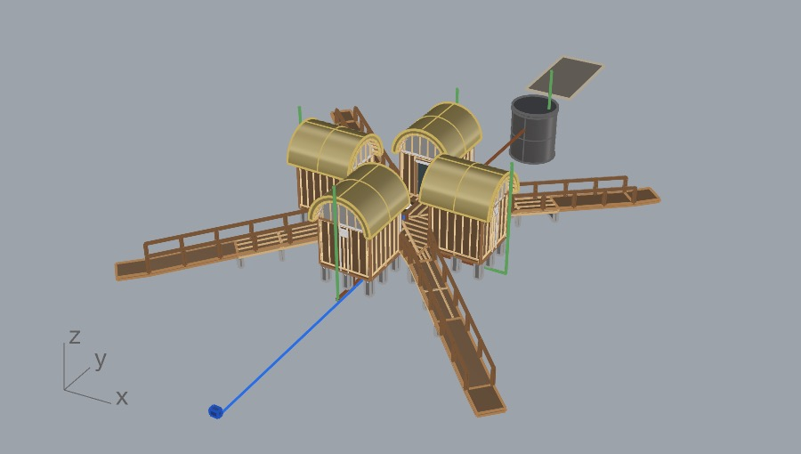

**Option F (run 8), layout D without the fifth unit, two ramps and two steps.**

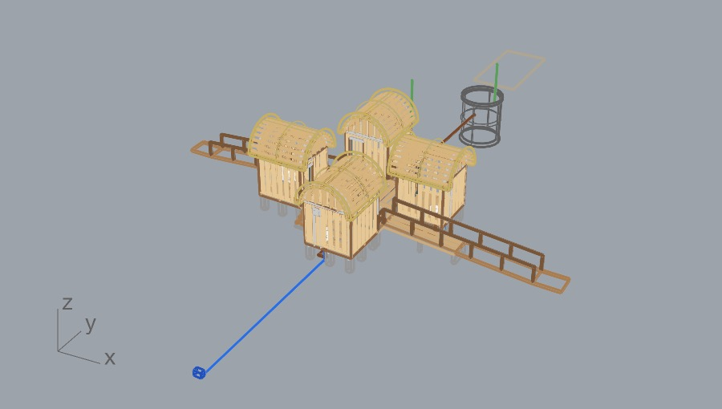

**Option G (run 9), F with a 10% single-slope metal roof.**

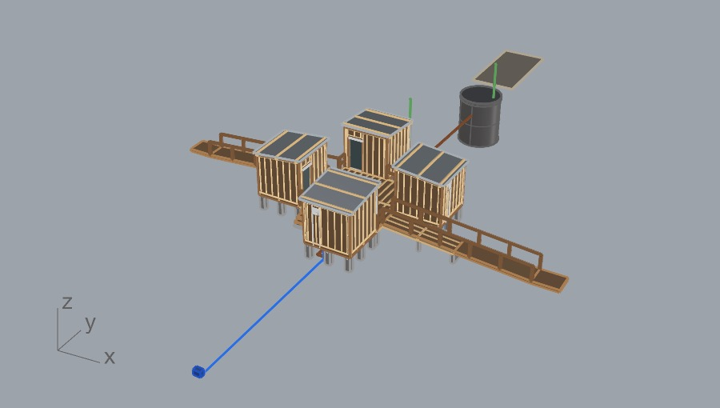

**Option H (run 10), compact 2 + 2 on a 1.70 m hall, one ramp.** The hall is open to the sky; the basin counter is at the far end.

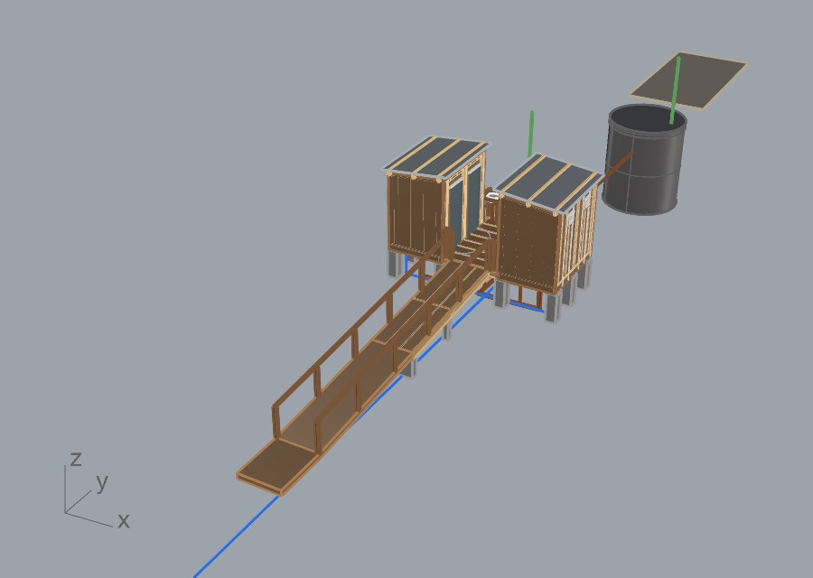

---

## 6. Metrics

### 6.1 Session numbers

| | 9 November (panel) | 10 November, panel session 1 | 10 November, panel session 2 |
|---|---:|---:|---:|
| Window (UTC) | 17:19–22:41 | 16:16–18:24 | 18:24–22:43, crash 18:36–21:40 |
| Our messages | 46 typed, plus 3 answer sets | 19, including 3 answer sets and 2 images | 14, including 1 answer set |
| Model responses | 333 | 105 | 98 |
| Tool calls | 450 | 107 | 94 |
| `run_python` | 272 | 88 | 54 |
| `get_viewport_image` | 141 | 12 | 24 |
| `run_command` | 0 | 1 | 4 |
| `ask_user` | 3 | 3 | 1 |
| Tool calls that returned an error | 16 | 2 | 2 |
| Context compactions | 5 | 1 | 0 |

9 November also had 23 `save_doc`, 5 `set_camera`, 3 `get_context` and 3 Grasshopper tool calls. Its `run_python` scripts total 10,212 lines (median 25, longest 368). By phase: modeling 160 scripts (17:19–21:18), the A-101 sheet 60 scripts (21:18–22:11), lessons write-up and A-102 to A-105 52 scripts.

The separate runs started from the chat channel on 10 November (run 12 build, run 12 screenshots, two run 13 attempts, two dimension attempts) are **not counted** in the table.

**Cost.** 9 November: the run cost counter read USD 49.75, covering 7 November about 21:22 UTC to the end of the session; 877,645 of its 939,985 output tokens were produced on 9 November. 10 November: **not computed**.

### 6.2 BOM and cost by option

All costs are **materials only**, from one home-improvement chain's online listings, converted to USD at the rate each estimate recorded. They exclude labour, delivery, fasteners, fittings, reinforcement, door hardware and flashings, and several lines are proxies (section 6.3). Treat them as a comparison between options, not a budget.

| Option | BOM objects | Building, USD | With septic pit and chamber (placeholder), USD | Priced on |
|---|---:|---:|---:|---|
| A (row 6) | 1,875 | 31,766 | (included) | 9–10 Nov, partial, before thatch and pit works |
| B (row 6) | 1,705 | 29,854 | (included) | same |
| C (row 6) | 2,011 | 33,953 | (included) | same |
| D (row 6) | 1,660 | 29,223 | (included) | same |
| H | 488 | 8,856 | 10,362 | 10 Nov |
| I, two ramps | 461 | 8,685 | 10,187 | 10 Nov |
| I, single ramp | 431 | 8,043 | 9,544 | 10 Nov, run 11 prices not re-checked |
| J, slab on grade | 328 | 6,733 | 8,167 | 10 Nov, run 11 prices not re-checked |

The row 6 totals (A to D) were assembled in a separate costing pass from the row 5 and row 6 BOMs, two retailer passes and our questions; they cover five larger units with decks and are **partial**: thatch, the inspection chamber, 50 mm drains, pit excavation and labour are not in them. Options E, F and G have no BOM or cost.

What moved between I with a single ramp and J (building, USD): structure −1,140, concrete +592, envelope −214, deck and guards −502, plumbing −45. A paper swap of option I's walls and roof to structural insulated panels (SIPs), from published panel prices, added about USD 1,600 (range USD 900 to 1,600 depending on the supplier listing), before any labour saving.

Like for like: H's total includes about USD 400 of sinks, faucets and counter that I does not have. On the same basis I costs about USD 220 more than H, mostly from the second ramp.

### 6.3 What the cost estimates rest on

- Sizes the retailer does not list were priced from proxies: 2x8 scaled from the 2x6 price by section, 25 mm subfloor as 18 mm board, 50 mm drain as 63 mm, 80x80 posts as round poles.
- All 2x6 priced as treated pine at 4.00 m, the largest single line.
- Concrete from 25 kg bags at an assumed mix; no reinforcement.
- Doors are interior doors facing an open deck; durability not checked.
- The weather barrier is not priced: the retailer does not appear to sell one.
- Run 13 excavation (36.8 m³) is quantified and left unpriced.
- Regular prices, not that week's sale prices. Tax inclusion assumed, not confirmed by the listings.
- Only the retailer pages its site rules permit were read (section 8.2); the marketplace was not priced.

---

## 7. Outputs

| Output | Count |
|---|---:|
| Options | 10 (A to J) over 13 runs |
| Rhino files | 4 on 9 November; 8 more on 10 November (an extract of option D, one file per run 7 to 12, and a combined runs 6–13 file with dimensions) |
| Grasshopper definitions | 6 (rows 1 to 6) |
| Generator scripts | One per row or run; 1,041 lines by run 13 |
| PDF sheets | 5 (A-101 to A-105), plus 1 failed soft-shadow test |
| PNG exports, 9 November | 68 (shaded, Arctic, Arctic with translucent ground, Pen) |
| Screens, 10 November | 4 views of run 12; 4 dimensioned plans of runs 12 and 13 (JPG and PNG) |
| BOM CSV files | 13: rows 5 and 6 (4 layouts each), H (plus a Spanish copy), I, I single ramp, J |
| Cost estimates | Row 6 A to D; H, I, I single ramp, J; a SIP variant of I (not saved to a file) |
| Final checker state, 9 November | 391/391, 26 not measured |

### 7.1 Files in this folder

| Path | What it is |
|---|---|
| `images/` | Five sheets, eight views and four option captures (E to H); see sections [5](#5-options-a-to-j) and [10](#10-images-in-this-folder) |
| [`data/bom-row6-layout-A.csv`](data/bom-row6-layout-A.csv) | The row 6, layout A BOM behind A-101's BOM table (121 lines) |
| [`data/bom-run13-option-J-slab-on-grade.csv`](data/bom-run13-option-J-slab-on-grade.csv) | The option J BOM (103 lines) |
| [`scripts/toilet_building_gen_r13.py`](scripts/toilet_building_gen_r13.py) | The run 13 generator: row 6 layouts A to D, options F, G, H and J |

Changes from the working files: utility and place names replaced in names and comments ("Water meter", "Septic pit", "local code minimum"). Quantities, geometry and logic are unchanged. The script has been byte-compiled; it has **not** been rerun in Rhino for this publication.

The generator returns `(layer path, name, Brep)` tuples and does not touch the document. A minimal bake in Rhino 9's Python 3 editor (**unverified**: not run for this publication):

```python
import Rhino
doc = Rhino.RhinoDoc.ActiveDoc
exec(open("toilet_building_gen_r13.py").read())

def layer_index(path):
    parent = None
    for i, part in enumerate(path.split("::")):
        full = "::".join(path.split("::")[: i + 1])
        idx = doc.Layers.FindByFullPath(full, -1)
        if idx < 0:
            lay = Rhino.DocObjects.Layer(); lay.Name = part
            if parent is not None: lay.ParentLayerId = doc.Layers[parent].Id
            idx = doc.Layers.Add(lay)
        parent = idx
    return parent

for path, name, brep in generate_j():          # or generate(2.40), generate_f(), generate_g(), generate_h()
    attr = Rhino.DocObjects.ObjectAttributes(); attr.Name = name; attr.LayerIndex = layer_index(path)
    doc.Objects.AddBrep(brep, attr)
doc.Views.Redraw()
```

Document units must be metres.

---

## 8. Corrections and failures

Failures sit here next to the results they affect. Most were caught; some were not.

### 8.1 Misreadings and corrections

- **"Run" read as a new version** (9 Nov). Claude cleared row 1 to build row 2. It said: "I read 'second run' as a new version, not a second row, which was my mistake." It restored row 1.
- **"Vent", three rounds** (9 Nov). A room louver; then a 110 mm plumbing vent per toilet; then, at our request, one vent on the septic pit and the louvers back. Claude's notes: the useful part was the physics, and a short question would have saved a rebuild.
- **"Them" in "raise them to 18in"** (9 Nov). Claude took it to cover joists and girders, said so, and did not ask.
- **"Option D (the straight option)"** (9 Nov). Our message contradicted Claude's notes (D was the pinwheel). Claude caught it and asked.
- **Print colour** (9 Nov). Asked whether A-101 would print in black and white, Claude answered colour, because it had exported with the colour setting. We answered black and white.
- **Toilets and doors** (9 Nov). Rows 1 to 4 ignored the door when placing the toilet. We caught it, not the checker.
- **"Further underground"** (10 Nov). The slab option put the pipes higher, not deeper. Claude explained why instead of digging deeper to match the words.
- **The scribble** (10 Nov). Claude stated its reading of our markup before building, and it was right.

### 8.2 Failures

- **The checker passed defects.** Row 1 passed 267/267 while cold-water risers ran through piers, basin drains stopped short of the basins and a counter was supported at one end. Claude found these with its own clash script. ASCheck had no clash or connectivity test then.
- **Requirements tuned to the design.** Before the first build Claude adjusted ranges (thatch height, ramp depth, step height) to the design it already had; some count ranges were very wide (20 to 400 piers). Its words: "It mostly confirms the model matches my own plan." On 10 November the new checker flagged this in its status lines ("2 revisions written after geometry existed", "3 count ranges too wide").
- **The anchor bolt.** Row 6 counts 81 anchor bolts in layout A and they passed every check. Detail D2, cut through a pier, shows the bolt in the seam between the two girder plies, stopping 11 mm below the girder top, with no nut or washer. Claude: "That isn't a buildable connection." The same detail carried into options E and F, flagged each time. Only one bolt was cut. A later rerun of row 6 with the newer checks scored it 435/443: 16 sloped ramp joists per layout overlapping a girder ply or deck framing, and a cold-water main stopping 167.5 mm short of the meter box, in all four layouts. Neither was fixed in the model.
- **The Arctic batch came out in colour** (9 Nov). The viewport showed Arctic; the 12 files measured 12.4% to 17.6% tinted pixels, plus red from a temporary colour on the pit. Claude had dropped its colour check for that batch. The fix named the display mode in the capture and failed the batch on any coloured pixel; the re-export measured 0.0%.
- **Two timeouts and the Pen batch** (9 Nov). Two `run_python` calls ran 383 s and 300 s with no output while rewriting 12 Pen views. The next Pen images came out faint and coloured until Claude let Rhino process its events before each capture.
- **Save counts that looked wrong.** `save_doc` reported 17,585 objects at row 1 against 3,467 expected; the count includes deleted objects held for undo. Claude read every saved file back with `File3dm.Read`. The same thing happened on 10 November (7,396 against 7,391).
- **Grasshopper.** `g1_start` failed; a later bake after an interrupted solve returned 0 solids and cleared a row (checker 126/351); the retry worked.
- **Text width.** Claude assumed 1.9 mm per character for 3.5 mm bold text; it measured 2.8 mm after two labels overran into the title column.
- **Soft shadows** (9 Nov, last test). No cast shadows appeared on A-103; Claude did not find out why. The test PDF is not published.
- **Option H lost its roof** (10 Nov). Its two roof sheets were missing from the run 11 file and the run 10 file on disk. Found by Claude during a comparison; cause not found.
- **White viewport** (10 Nov). After many off-screen captures the main viewport showed only white and we could not work. Claude found a camera zoomed out until it flipped, reset it, and when that did not help said Rhino's window had probably stopped repainting, and stopped capturing for the rest of the session. We saved and later reopened Rhino.
- **Separate runs and the operator's Rhino** (10 Nov). The runs started from the chat channel could not open a new Rhino 9 window, and their Rhino 8 fallback hung or failed to connect three times. One dimension attempt then opened the run 12 file as a new document in the operator's running Rhino 9, and Rhino froze while saving the first screenshot, with two other documents unsaved. The run did not force-quit anything. Rhino was later reported crashed; whether that was the same freeze is **not established**.
- **Pricing access** (10 Nov). The retailer's site rules disallow its search pages for automated agents, so Claude used only the category and product pages they permit. The marketplace's listings redirected to an account-verification page; Claude stopped there and did not try to get around it, so no marketplace prices were used.
- **Errors**: 16 tool errors on 9 November (14 `run_python`, including the two timeouts; 2 Grasshopper), 4 on 10 November in the panel (an open command that did not report completion, a quoting typo, an API spelling of `Millimeters`, a dimension replace call). None changed the model.

---

## 9. Lessons learned

At the end of 9 November we asked Claude to write up its lessons. It wrote 70, each tagged with its evidence. We kept those backed by a correction, a failure and fix, or a measurement, and added the ones 10 November produced. They were written by the session that did the work; no architect reviewed the models.

**Working with the brief**

1. **A new "run" is a new row in the same model. Never clear earlier versions.** Check: after a request for another version, every earlier row is still in the model.
2. **Ask in one batch, before modeling, and propose an answer for each question.** 22 questions on 9 November changed the design (the fifth unit, all four layouts, the stand-in flag). On 10 November, run 11's five questions came with proposed answers and we accepted all five in one go.
3. **Name the ambiguity when a word has two building meanings** ("vent", "them"). Ask or state the reading before building.
4. **Say what a request costs.** Full symmetry removed the accessible unit; Claude said so in the same reply. "Further underground" made the pipes shallower; Claude explained instead of complying literally.
5. **Do not supply code values from memory.** Claude read the local code, found no rule for public toilet size, and asked us which published minimum to use. The model records the source of each value.

**Geometry**

6. **Plan fixtures and doors together.** Rows 1 to 4 got this wrong; row 5 settled swing, hinge, toilet and turning circle as one decision.
7. **Test the driver across its range, then publish the range that works** (row 6's slider minimum rose to 2.30 m).
8. **A height change cascades.** 0.08 m more floor added 1.00 m to each ramp; hanging joists flush saved 0.17 m of height.
9. **Hardware placeholders are risky once they look real.** Cut one typical connection of each type before calling structure complete, and name placeholders as placeholders.
10. **A passing score is not a clean model.** Seed a known defect (a riser through a pier) and require the checker to fail it.
11. **A checker marks its own homework when its ranges follow the design.** Flag ranges written after geometry exists; fail ranges much wider than the layout implies.
12. **Check earlier options still exist after each run.** H lost its roof sheets between runs and no check caught it; a count by option against the last BOM would have.

**Rhino mechanics**

13. **Check the baked count after every bake,** and enumerate with hidden and locked objects included.
14. **Read saved files back.** `save_doc` counts deleted objects; `File3dm.Read` and a count, a named object and a layer path settle it.
15. **Viewport captures have side effects.** They left a camera broken and, later, a window that would not repaint. Capture sparingly, restore the view, and stop when the user's screen misbehaves.
16. **Run separate agents headless, not in the user's Rhino.** Separate runs that needed a Rhino window failed to start one or hung; the one that used the open Rhino 9 froze it.
17. **Files are a working hand-off.** The run 13 generator written by one run was found, read and baked unchanged by another hours later. Write generators as standalone scripts with named constants.

**Exports and sheets**

18. **Verify the exported file, not the viewport.** Fail a black-and-white batch on any coloured pixel.
19. **Use temporary colours not at all, or restore them before capture.**
20. **For true black-and-white vector sheets, use `HiddenLineDrawing`,** not a display mode.
21. **Measure text; do not estimate it.**
22. **A detail bubble is a locator,** so project the real joint to place it.
23. **Verify a PDF by parsing it, and check that the parser finds something.**

**BOMs and costs**

24. **Default to everything in the model, and fail on an unclassified object.**
25. **Object names make the BOM.** A generic name loses the item.
26. **List what is not counted, with the reason.** An unmentioned omission reads as zero.
27. **A count does not validate the thing counted** (bolts, hangers).
28. **Compare costs like for like,** and say what one option has that the other lacks (H's sinks).
29. **Respect a site's rules for automated access,** and say which prices are proxies.

### 9.1 What the session does and does not establish

| Claim | Result |
|---|---|
| Claude modeled, drew and took off quantities by script in Rhino 9 | Yes, under a skill that told it to build by script |
| Ten options were built and checked | Yes for A to I against Claude's own requirements; I single ramp and J were not run through the checker |
| The checker verified the geometry | No on 9 November (no clash or connectivity test); the newer checks found 8 failures on row 6 that the old one passed |
| The framing is correct | Not established: nothing was engineered; WFCM chapters not read; WCD1 read as figure labels |
| Anchor bolts are valid connections | No: one cut showed an 11 mm gap and no nut or washer |
| The sheets are ready to print | Not established: none was printed; line weights were accepted on screen |
| The options meet local code | Not established: one code's room minimums were read on 10 November and applied to H and I; accessibility values were skipped at our request; the accessible toilet is not modeled for E to J |
| The costs are a budget | No: materials only, partial, with proxies |
| The skill improved the result | Not established: no run without the skill |

---

## 10. Images in this folder

The five sheets are exported from the session's PDFs. On every sheet the first two title-block lines (client and place) were replaced with "TOILET BUILDING / Concept study, coastal site", in the same font and size, and on A-101 the last note line now ends "for the site". Nothing else on the sheets was changed. A-101 is re-rasterized from the vector PDF at 150 dpi; A-102 to A-105 at 100 dpi from their full-page raster. The other images are the session's own exports, converted to greyscale where they were already black and white, and downsized to 2,400 px wide where larger.

**A-101, exploded framing axonometric, row 6, layout A** (1:40, details D1 and D2 at 1:5). Floor framing at grade, walls raised 3.00 m, roof framing raised 6.00 m; framing key, notes, framing BOM table and title block in the right-hand column.

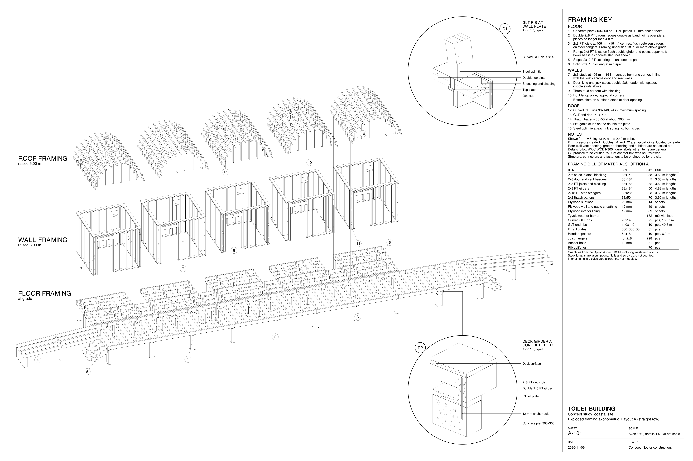

**A-102 to A-105, axons of layouts A to D.** A-102 is at 1:60; A-103 to A-105 at 1:40.

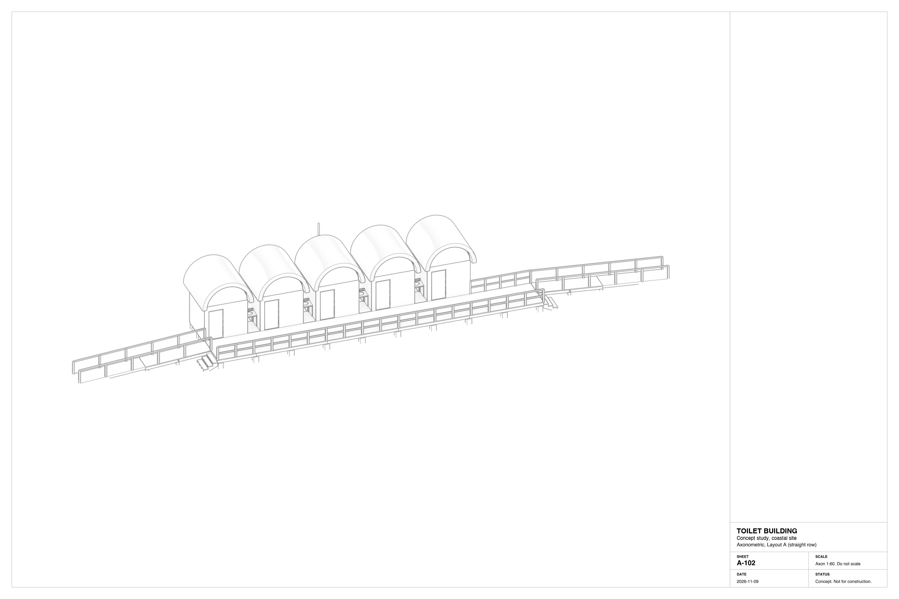

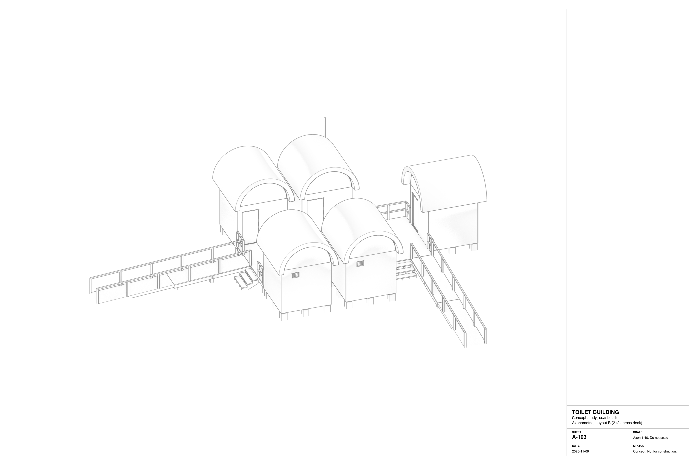

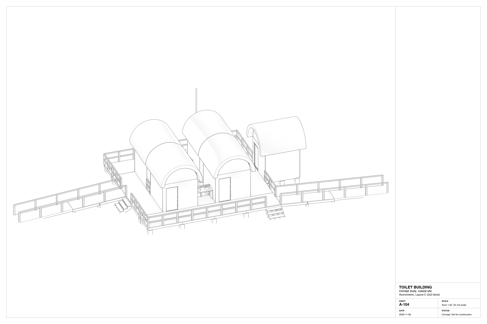

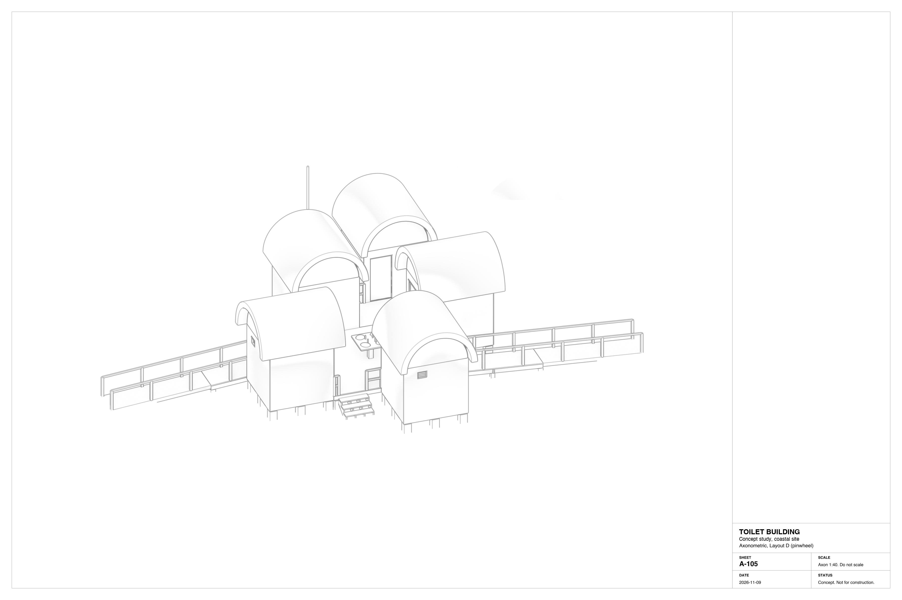

**Row 1, layout A, Arctic with a translucent ground.** Pyramid roofs, the long deck and ramp, the septic pit and truck strip behind.

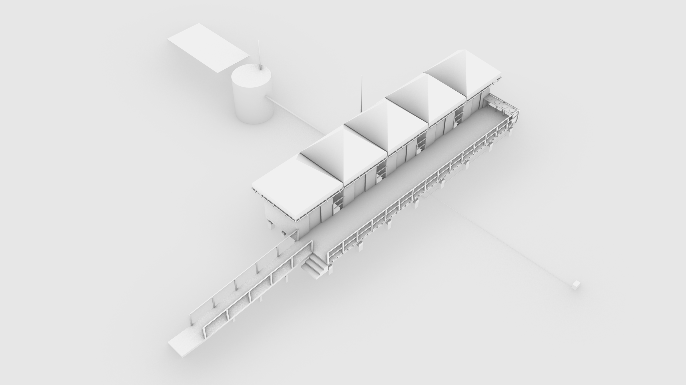

**Row 3, layout B, Arctic.** Vault roofs, entry and exit ramps.

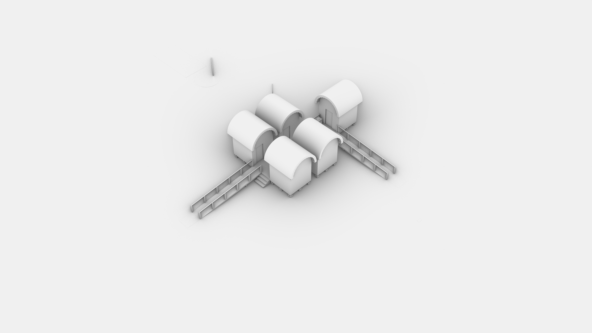

**Row 4, layout B, plan, roofs off, doors open, Pen.** Basins in a line down the centre of the deck, from our text-dot note.

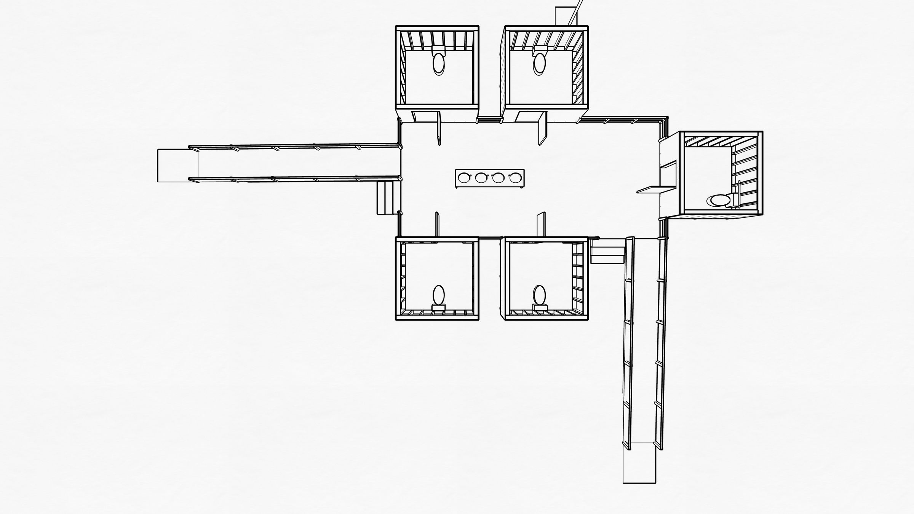

**Row 4, layout D, aerial, Pen.** The pinwheel with the square basin island.

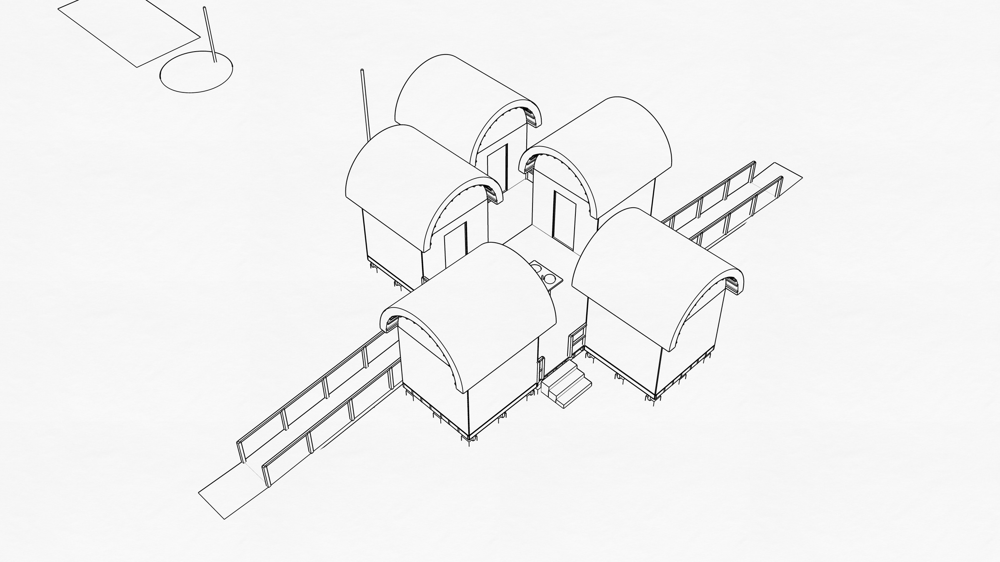

**Run 12, option I with a single ramp.** Perspective, plan with the roof off (doors swinging out onto the deck), and elevation. Site items are hidden.

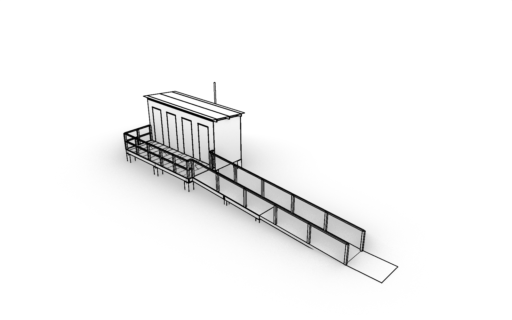

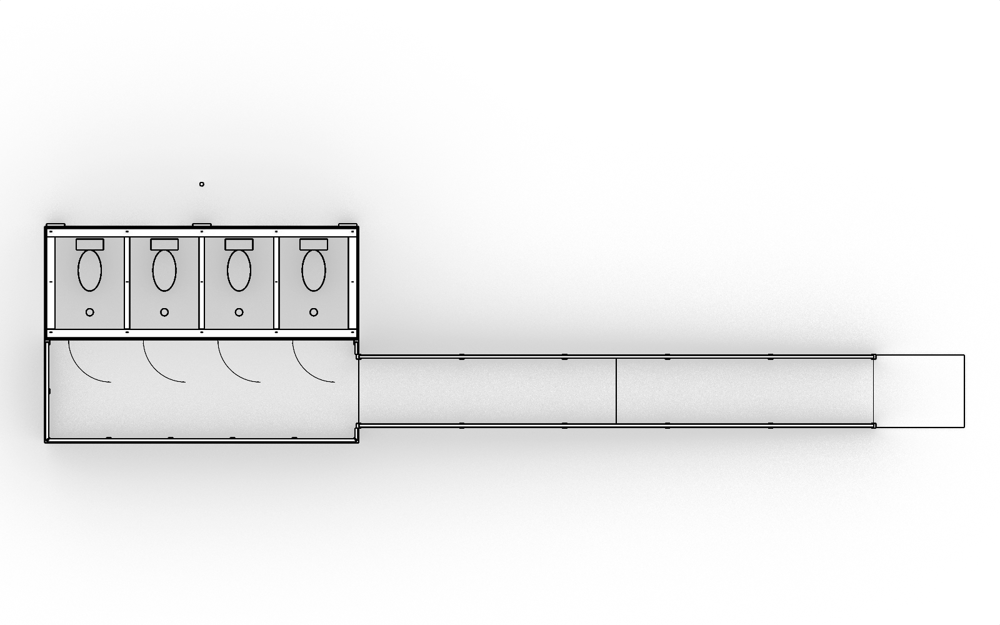

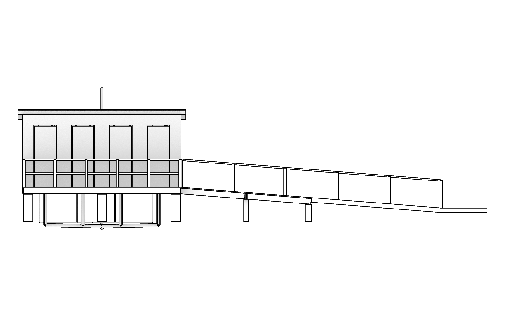

**Run 13, option J, slab on grade, dimensioned plan** (mm). Stalls 1,120 x 1,500, building 5,187 x 1,868, apron 1,700, 1:12 slope 1,600, overall 6,787.

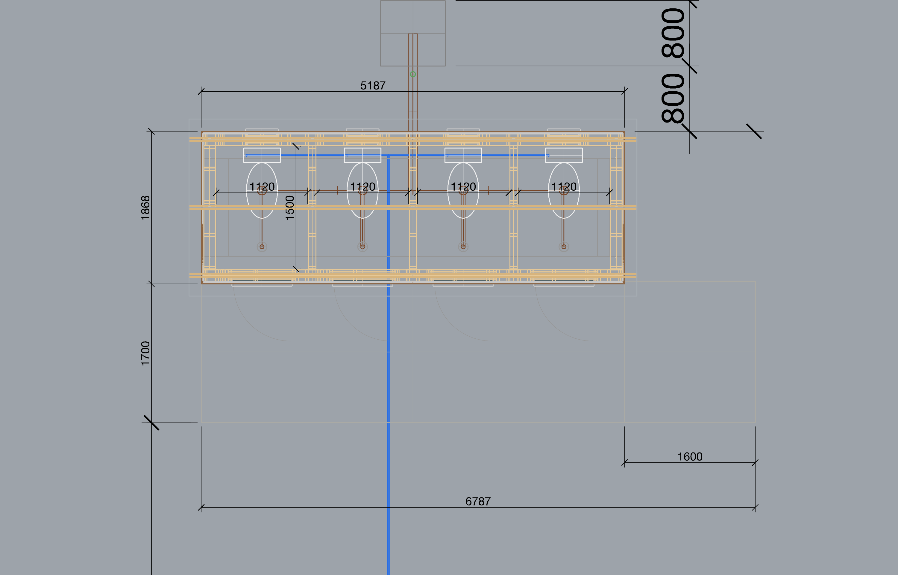

Options E to H are shown in [section 5](#5-options-a-to-j). Those four images are the session's in-chat viewport captures, recovered from the session record, cropped only to remove an edge of a neighbouring option; they are lower resolution than the exports above.

---

## Appendix: items we could not verify

1. Object counts, clash results and checker results we did not re-run; they are read from the transcripts and the session's reports.
2. The Rhino build number on 9 and 10 November (recorded 4 November).
3. The cost of 10 November.
4. The cause of option H's missing roof sheets and of the Rhino crash on 10 November.
5. Whether the generator in `scripts/` reproduces the published images when baked; it was not rerun for this publication, and the bake snippet was not run.
6. Retailer prices after 10 November, and whether listed prices include tax.
7. Tool counts for the separate runs started from the chat channel.
