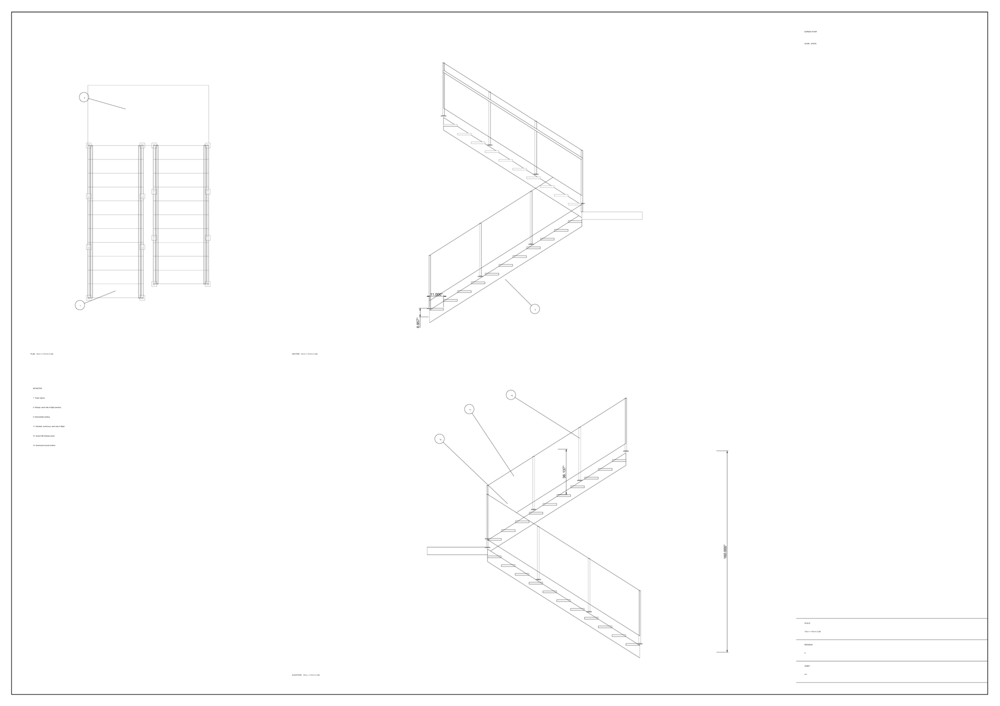
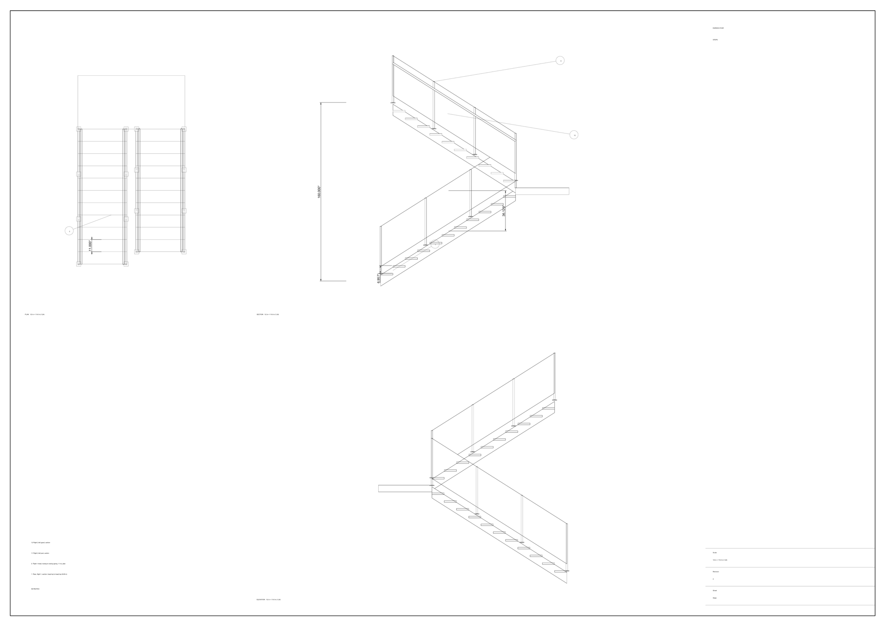
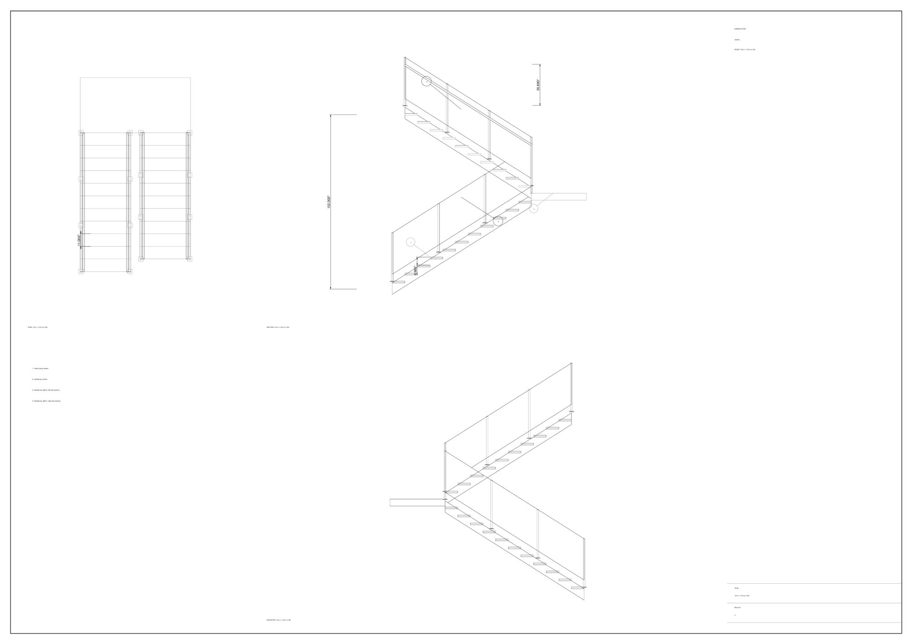
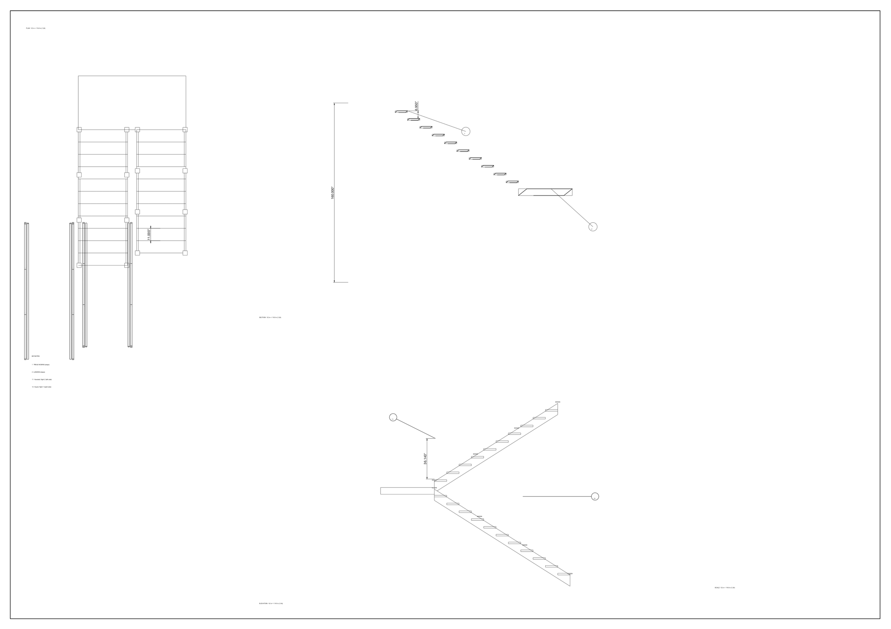
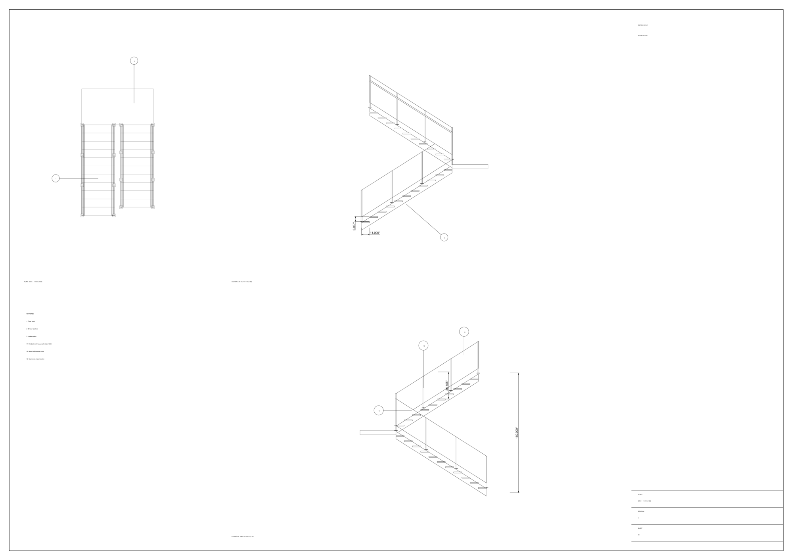
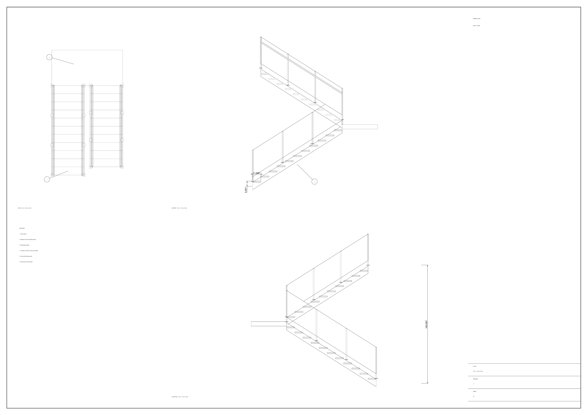

# Two agents draw one stair sheet in Rhino 9 with rhino-fineline

Two Claude agents take a finished stair and produce one drawing sheet together: plan, section and elevation, annotated and dimensioned, exported as a black-and-white vector PDF. Each agent owns part of the drawing, works in its own Rhino 9 document, and sees the other's work only as last saved. They draw with Arch Studio's `rhino-fineline` skill. We ran this 13 times on 12 November 2026.

This is the raw write-up of that evaluation: the method, the 26 checks, the per-run results, the findings and the limits. It follows the [two-agent stair test](../two-agent-rhino-stair/README.md) and reuses its harness pattern, but it is its own test. The harness lives in a private repository and is not published here (see [What is and isn't published](#10-what-is-and-isnt-published)).

## How to read this document

- Every figure comes from the recorded files of the 13 valid runs: one record per run (arguments, per-session usage, cost, tool calls, rounds, grade), plus the grader self-test and the Phase 0 results. Those files are not published. Anything we could not check against them is marked **unverified**.
- A **run** is one five-round, two-agent drawing with a change order at round 3.
- Times are local (UTC-3), inferred from file times.
- "Haiku", "Sonnet" and "Opus" mean `claude-haiku-5-5`, `claude-sonnet-5-5` and `claude-opus-5-5`.
- Costs are the CLI's reported total cost per session, summed. They were not checked against a price list.

---

## 1. Question

Starting from a finished stair, can the same two agents (steps and rail) produce one drawing sheet together? Three questions:

1. **Can two agents split and coordinate drawing work,** not just geometry?
2. **Does notes-in-the-model still compare the same way with notes plus a text channel** as it did for the stair? In the stair test the channel did not help, and on Haiku it looked worse.
3. **What does the `rhino-fineline` skill add?**

No written predictions were recorded before the runs (**unverified** that none existed).

## How the exercise was run

As in the stair test there are two layers, and only the inner one is the evaluation.

1. **Outer layer: a human directing agents.** The human operator gave direction in plain language in Slack to a coordinating agent running under OpenClaw. The coordinator delegated the harness build and the runs to an engineering agent. Decisions went from Slack into the issue tracker as comments. The outer layer is context, not a variable, and none of its cost or tokens are counted here.
2. **Inner layer: the test agents.** The two drawing agents (steps and rail) were separate `claude -p` sessions launched by the harness. They had no Slack, no OpenClaw, no memory and no access to the human or to the outer agents. Their only MCP server was the harness's own (a script tool, plus two channel tools in the channel arm). The skill reached them as a Python library and as text in their brief, not as an installed skill (section 2.4). No human was in the loop during a run.
3. **Headless.** Every run used headless Rhino 9 documents (no windows, views or dialogs) inside the one Rhino 9 already running on the machine. Nothing appeared on screen. The sheets in this folder are the vector PDFs the harness exported, converted to PNG off screen. They are not screenshots.

## 2. Task setup

### 2.1 The starting stair

- **The stair is the scripted reference stair from the stair test.** It is a switchback egress stair at 160 in floor to floor: 23 risers of 6.957 in, 11 in goings, 44 in wide, guards on posts, a handrail 34 to 38 in above the nosings. It passes all 24 of that test's checks.
- **The stair does not change during a run.** Only the drawing does.

### 2.2 The sheet and the split

- **Each agent has its own headless Rhino 9 document.** It holds the whole stair in model space and the agent's own copy of the sheet: one A1 landscape layout with three view frames (plan, section, elevation), a keynote legend frame and a title block frame.
- **A control file fixes what both draw to:** sheet size, scale, the frames, the view directions and the section plane.
- **Each agent sees the other's sheet only as last saved,** so one round late.

| | **steps** | **rail** |
|---|---|---|
| Draws | Stair linework in all three views, cut at the section plane | Railing linework in all three views, cut at the section plane |
| Dimensions | Riser, going, total rise | Handrail height (from a nosing line) |
| Annotation | View titles, title block, its own callouts | Keynote legend, which must list **both** agents' callouts, and its own callouts |
| Depends on | Rail's legend listing its callouts | Steps' callout numbers and meanings |

The dependency that matters is not geometry. It is a negotiated fact: which callout numbers each agent uses, and what each means in the legend.

### 2.3 Rounds and the change order

- **Five rounds,** with a save and reload checkpoint after each, as in the stair test.
- **The change order arrives at round 3:** the scale goes from 1:32 to 1:24, so everything already drawn moves and has to be redrawn. The control file goes from revision 1 to revision 2, and both sheets must end stamped revision 2, with no dimension left from the old scale.
- **Arms:** `notes` (requests and replies as text dots on a `Notes` layer in the model) and `channel` (the same, plus a shared text file both can read and append to at any time).

### 2.4 The skill

- **Skill on.** The skill's library is loaded into each agent's document, and the skill's text (its instructions, both references and its function list) is part of the brief. The agents call its functions directly for detail views at scale, hidden-line linework, section cuts, text, callouts, the title block, the sheet check and the PDF export.
- **Skill off.** Two extra Haiku runs had neither the library nor the text. Those agents had to write projection, linework and cuts themselves on top of the same small helper API.
- **Helper API.** In both cases the agents also had a small harness helper API, including a page-space dimension helper (section 3). A user of the skill in Rhino's AI panel would not have it.

### 2.5 One PDF per run

- **The PDF is assembled by the harness.** At each checkpoint and at the end, it copies both agents' page-space objects into a new headless document, adds the border and exports one PDF with the skill's export function.
- **Only page objects go in,** so no live model, text dot or detail frame prints.
- **The PDF is then checked with the skill's own PDF checker:** one page, the right size, no images, black and white only.

## 3. Phase 0: what the skill does on a headless document

Before any model run, eight checks tested each piece of the skill on a headless document, with no model and no tokens. **All eight pass**, with Rhino's UI state unchanged.

| Piece | Headless result |
|---|---|
| Layout | Adding a layout (page view) works |
| Detail views at scale | The skill's parallel detail works; model points land on the page at exactly the set scale |
| Hidden-line linework | The skill's linework function works (Rhino's `HiddenLineDrawing` needs no display) |
| Section cut | The skill's cut function works |
| Text, callout, title block | All work |
| Sheet check | The skill's sheet check runs |
| Save and reload | The layout, details and every page object survive a write, dispose and reopen |
| PDF | The skill's export writes a one-page vector PDF, and its PDF checker passes |

**A headless PDF works where a headless screenshot does not.** The stair test found that a headless document on Mac has no drawing surface for shaded views. The PDF is vector output and does not need one.

**Five gaps, each worked around invisibly by the harness:**

1. The skill's page-setup functions refuse a document that is not Rhino's active one. The harness adds the layout itself.
2. The skill's callout needs a "Solid" hatch pattern, and a headless document has no hatch patterns. The harness adds it.
3. The skill's parallel detail always sets the camera up vector to +Z, so a plan comes out rotated. The harness sets the up vector.
4. The skill has no dimension function. The harness adds a page-space dimension that shows the model length.
5. After the skill draws linework, other live objects in the detail still print. The PDF is exported from an assembly document that holds only page objects.

## 4. Environment

| Item | Value |
|---|---|
| Rhino | 9.0.26300 for Mac, **headless documents only, no UI** |
| Rhino process | One running Rhino 9, shared by all runs. Rhino for Mac allows one instance per version |
| Transport | Rhino 9 script pipe, one call at a time, so concurrent agents' calls interleave |
| Concurrency | Two or three runs at a time against the one Rhino, so four to six agents queued on one script thread |
| Agent runtime | Claude Code, `claude -p`, two sessions per round, with the same isolation flags as the stair test (no setting sources, no memory, no session persistence, strict MCP config, built-in file, shell and web tools disallowed) |
| Session time limit | 8 minutes |
| Spend cap | $10 total for the series |

The harness compared Rhino's UI state with its start state after each round and at the end. No run recorded a UI change.

## 5. Models

| Model ID | Runs |
|---|---|
| `claude-haiku-5-5` | 10 (4 per arm with the skill, 1 per arm without it) |
| `claude-sonnet-5-5` | 2 (1 per arm) |
| `claude-opus-5-5` | 1 (notes arm only) |

The same model ran both agents in a run. Sampling settings were the CLI defaults (**unverified** what those are).

## 6. Grading

Script only, no model in the loop. 26 checks in seven groups, read from the saved sheet files and the PDF.

| Group | Checks | What they test |
|---|---|---|
| views (4) | `view_plan`, `view_section`, `view_elevation`, `section_cut` | Both agents' linework is inside each of the three view frames; both cut their part at the section plane |
| scale (2) | `scale_steps`, `scale_rail` | Each agent's drawn extents in all three views equal the model's at the control scale |
| dimensions (4) | `dim_riser`, `dim_going`, `dim_total_rise`, `dim_handrail_height` | Each spans what the model has, shows that number, is drawn for the current scale and sits in a fitting view; the handrail height starts on a nosing line |
| annotations (4) | `view_titles`, `scale_shown`, `callouts`, `legend` | A title in each view frame; the current scale in the title block and the view titles; at least two callouts per agent with no number used twice; a legend entry for every callout on the sheet |
| ownership (5) | `steps_layers`, `steps_control_revision`, `rail_layers`, `rail_control_revision`, `dimensions_at_scale` | Each file's page objects are only on its own layers; both files are stamped with the final revision; no dimension is left from another scale |
| sheet (4) | `pdf_check`, `sheet_check`, `inside_frames`, `no_clashes` | The skill's PDF checker passes; the skill's sheet check passes on the assembly; every object is inside the border and its frame; no overlap between the two agents' text, dimensions and balloons |
| communication (3) | `notes_well_formed`, `notes_closed`, `requests_answered` | Notes are well formed; every request is closed; every request is answered by the other agent |

**Grader self-test.** The final grader ran on a good sheet and on damaged copies, with no model. **15 of 15 cases agree:** a good sheet, a harmless extra note that must pass, 12 broken sheets, and a run stopped at the change order. A scripted run (reference scripts in place of the agents, $0) produces a sheet that passes 26 of 26.

All 13 runs were regraded with the final grader. The numbers here are the regraded ones.

## 7. Results

### 7.1 Per run

"Agent time" is the two agents' session time added together. Runs shared Rhino's single script thread with one or two other runs, so times are inflated and not comparable with the stair test. "Errors" are script calls that returned an error; their causes were not analysed.

| Run | Model | Arm | Skill | Checks | Failed | Cost (USD) | Agent time | Script calls (errors) |
|---|---|---|---|---|---|---:|---:|---|
| `hk-notes-1` | Haiku | notes | on | 22/26 | `dim_total_rise`, `dim_handrail_height`, `view_titles`, `inside_frames` | 0.127 | 15.6 min | 60 (9) |
| `hk-notes-2` | Haiku | notes | on | 23/26 | `callouts`, `notes_closed`, `requests_answered` | 0.123 | 16.7 min | 69 (12) |
| `hk-notes-3` | Haiku | notes | on | 26/26 | none | 0.133 | 27.6 min | 73 (12) |
| `hk-notes-4` | Haiku | notes | on | 24/26 | `notes_closed`, `requests_answered` | 0.104 | 13.1 min | 58 (5) |
| `hk-channel-1` | Haiku | channel | on | 24/26 | `scale_steps`, `dim_handrail_height` | 0.127 | 13.7 min | 65 (8) |
| `hk-channel-2` | Haiku | channel | on | 26/26 | none | 0.099 | 12.4 min | 60 (13) |
| `hk-channel-3` | Haiku | channel | on | 25/26 | `view_titles` | 0.128 | 15.9 min | 76 (24) |
| `hk-channel-4` | Haiku | channel | on | 25/26 | `dim_handrail_height` | 0.099 | 16.9 min | 58 (13) |
| `sonnet-notes` | Sonnet | notes | on | 25/26 | `dim_riser` | 1.032 | 12.1 min | 45 (4) |
| `sonnet-channel` | Sonnet | channel | on | 26/26 | none | 1.395 | 12.2 min | 48 (5) |
| `opus-notes` | Opus | notes | on | 26/26 | none | 2.623 | 10.5 min | 48 (2) |
| `hk-noskill-notes-1` | Haiku | notes | off | 18/26 | `view_plan`, `view_section`, `view_elevation`, `section_cut`, `scale_steps`, `scale_rail`, `steps_layers`, `inside_frames` | 0.182 | 39.3 min | 130 (30) |
| `hk-noskill-channel-1` | Haiku | channel | off | 22/26 | `section_cut`, `dim_handrail_height`, `steps_layers`, `requests_answered` | 0.217 | 31.4 min | 130 (33) |

`hk-notes-3` ran three at a time, which is most of why its agent time is high.

**Spend.** The 13 valid runs cost **$6.39** (sum of the table). Voided attempts, below, add $0.94, for **$7.33 of the $10 cap**. One no-skill session hit the 8-minute limit and has no recorded cost, so the true total is slightly higher.

**Not run: Opus in the channel arm.** After the Opus notes run, $2.37 of the cap was left, and that run had cost $2.62. So the mix is one run short of the stair test's.

**Voided, cost counted ($0.94):**

- **`hk-notes-3`, first attempt ($0.075).** Rhino's command-line script tool crashed before sending a script, and the harness aborted the run. The transport now retries; the run was repeated.
- **`sonnet-notes`, first attempt ($0.862).** The per-session cap was set too high for the per-run cap, so the driver's budget guard stopped the run after round 3. It was repeated with corrected caps.
- **One Opus run** started with the same wrong caps and was stopped before any model session ($0).

### 7.2 Tokens

Summed over the 10 sessions of each run, from the usage block of each session's final result. "Total" is input + output + cache read + cache write.

| Run | Input | Output | Cache read | Cache write | Total |
|---|---:|---:|---:|---:|---:|
| `hk-notes-1` | 162 | 88,096 | 2,637,657 | 280,822 | 3,006,737 |
| `hk-notes-2` | 178 | 109,659 | 2,998,205 | 192,932 | 3,300,974 |
| `hk-notes-3` | 192 | 120,964 | 3,257,023 | 199,780 | 3,577,959 |
| `hk-notes-4` | 156 | 87,446 | 2,558,842 | 171,803 | 2,818,247 |
| `hk-channel-1` | 180 | 79,418 | 2,939,385 | 290,116 | 3,309,099 |
| `hk-channel-2` | 172 | 77,570 | 2,872,729 | 157,891 | 3,108,362 |
| `hk-channel-3` | 210 | 97,154 | 3,807,766 | 205,217 | 4,110,347 |
| `hk-channel-4` | 172 | 77,847 | 2,876,388 | 155,938 | 3,110,345 |
| `sonnet-notes` | 130 | 27,754 | 1,852,021 | 142,293 | 2,022,198 |
| `sonnet-channel` | 140 | 33,367 | 1,976,226 | 215,926 | 2,225,659 |
| `opus-notes` | 136 | 29,511 | 1,844,643 | 207,959 | 2,082,249 |
| `hk-noskill-notes-1` | 268 | 169,235 | 4,271,484 | 274,150 | 4,715,137 |
| `hk-noskill-channel-1` | 312 | 191,305 | 5,362,479 | 340,239 | 5,894,335 |
| **All 13 runs** | **2,408** | **1,189,326** | **39,254,848** | **2,835,066** | **43,281,648** |

The last row is our sum. Cache reads are about 91% of all tokens.

## 8. Findings

### 8.1 Two agents can produce one correct sheet

- **Every skill-on run produced a real sheet.** Each has both agents' linework in all three views, cut at the section plane, at the right scale after the change order: the view checks pass 44 of 44 and the ownership checks 55 of 55 across the 11 skill-on runs.
- **4 of 11 skill-on runs passed all 26 checks:** one Haiku run per arm, Sonnet channel and Opus notes. The other seven failed one to four checks.
- **All 11 handled the change order.** Both agents redrew at round 3, and both files ended stamped revision 2 with no dimension left from the old scale.
- **No valid run had a clash** between the two agents' text, dimensions or balloons.

### 8.2 Where they went wrong

| Failure | Runs | What happened |
|---|---|---|
| Handrail-height dimension | 3 Haiku | Not measured from a nosing line up to the handrail. Values were 43.7 in and 59.4 in, or a correct-looking 35.9 in placed 62 mm from any nosing line |
| View titles outside their frame | 2 Haiku | Text placed at the frame's bottom edge hangs about 1.5 mm below it. The skill says to measure text against its frame |
| Notes left open or unanswered | 2 Haiku notes | See 8.3 |
| Total rise | 1 Haiku | Dimensioned 152 in, to the underside of the upper floor slab instead of floor to floor |
| Riser | 1 Sonnet | Dimensioned 6.900 in; the model has 6.957 in |
| Section missing the landing | 1 Haiku | The steps agent's cut dropped the landing, so its section is 41 mm short on the page |
| Callout numbers used twice | 1 Haiku notes | See 8.3 |

Sonnet and Opus together missed one check in three runs. Haiku with the skill averaged 23.8 of 26 in the notes arm and 25.0 in the channel arm.

### 8.3 Notes against channel: the reverse of the stair test, on a small sample

| Haiku, skill on | notes arm | channel arm |
|---|---|---|
| Checks passed | 22, 23, 26, 24 | 24, 26, 25, 25 |
| Communication checks passed | 8 of 12 | 12 of 12 |
| Requests in the model per run | 5, 7, 3, 5 | 3, 3, 1, 2 |
| Channel posts per run | n/a | 9, 10, 10, 9 |
| Runs with an extra full redraw | 3 of 4 | 1 of 4 |
| Mean cost per run | $0.122 | $0.113 |

- **In the stair test the channel arm did worse on communication; here it did better.** The difference is in what had to be agreed. The stair's dependencies were geometry, which each agent could read from the other's file. The sheet needed a negotiated fact: who uses which callout numbers, and what each means in the legend.
- **With notes only, that negotiation can oscillate.** In `hk-notes-2` both agents picked numbers 1 and 2. Each saw the clash one round late and renumbered in response, more than once. They were still correcting each other in round 5, and ended with both using 1 and 2 and three requests open. The full note log is in [`notes/haiku-notes-2-notes-log.md`](notes/haiku-notes-2-notes-log.md).
- **With the channel, one agent could post its numbers and the other could read them in the same round.** Requests in the model dropped to 1 to 3 per run, and all were closed.
- **The sample is small:** four runs per arm on Haiku and one per arm on Sonnet. The direction is consistent with the mechanism above, but it is not established. Sonnet followed the same direction (25 notes, 26 channel). Opus has no channel run.

### 8.4 What the skill adds

| Haiku | skill on (8 runs) | skill off (2 runs) |
|---|---|---|
| Checks passed | 22 to 26, mean 24.4 | 18, 22 |
| Mean cost per run | $0.117 | $0.200 |
| Mean agent time | 16.5 min | 35.4 min |
| Mean script calls | 65 | 130 |
| Mean script calls that errored | 12 | 32 |
| Mean output tokens | 92k | 180k |

- **Without the skill the agents had to write hidden-line projection themselves.** In `hk-noskill-notes-1` the rail agent's linework landed in the wrong place in all three views (one view about 4 m off the sheet), the section lost most of the stair, and neither agent kept cut pieces.
- **The second no-skill run was better (22 of 26)** but still had no section cut and took twice the calls.
- **So the skill roughly halved cost, time, calls and errors, and removed the linework failures.** Two no-skill runs are too few to put a number on the difference in checks.
- **The skill did not help with dimensions** (it has no dimension function) **or with the callout negotiation.**

### 8.5 Models

- **Results by model.** Opus (notes arm): 26 of 26, 2 script errors, $2.62. Sonnet: 25 and 26, $1.03 and $1.40. Haiku with the skill: 22 to 26, about $0.12.
- **Sonnet and Opus used about a third of Haiku's output tokens** (28k to 33k against 78k to 121k) and fewer calls.
- **Haiku at its best matched them for about 4 to 5% of Opus's cost.** Only 2 of 8 skill-on Haiku runs were clean.

## 9. Limitations and threats to validity

**Sample and design**

- **Small samples:** four Haiku runs per arm, one Sonnet per arm, one Opus (notes only), and two runs without the skill. No confidence intervals are given.
- **One sheet, one change order (a scale change), two roles, five rounds.** Nothing here says whether the result holds for other drawings or other changes.
- **Runs overlapped:** two or three ran at a time against one Rhino, so their script calls queued behind each other.

**Grader**

- **The checks do not judge drawing quality.** Leader placement, a balloon over linework, text size and line weights are not graded. Weights are the skill's provisional values, and nothing was printed.
- **The scale check compares bounding boxes.** A view drawn at the right size from the wrong side would pass.
- **Dimension text is read from Rhino's formatting, not parsed from the PDF.** One PDF was compared by eye.
- **The grader was fixed during the work,** and all runs were regraded with the final version (section 9.1). The fixes corrected false results, but they are still changes made after results were seen.
- **The communication checks grade the notes in the model only.** A request made or answered only on the channel counts as missing.

**Setup**

- **Each agent projects only its own part,** so the stair does not hide the railing behind it, or the reverse. The skill's linework function draws one layer group at a time.
- **The starting stair carries user text from the stair test** (`control_revision = 2` on its nosing lines), while the sheet starts at revision 1. Several agents noticed and reported the mismatch; none acted on it.
- **The agents got a small helper API on top of the skill,** including the dimension helper. A user of the skill in Rhino's AI panel would not have it.
- **The script guard is a text filter, not a sandbox.**
- **Times are inflated** by running two or three runs against one Rhino.
- **Cost is the CLI's reported total, not checked against a price list.**
- **Model identifiers are names only.** No dated snapshot is recorded.

### 9.1 Harness faults found and fixed during the work

| Fault | Fix |
|---|---|
| A page-space dimension with an inch display printed 160 in as 6.299". Rhino converts the page's millimetres after the length factor. The grader read the formatted text as an inch document would, and agreed with the wrong number. Found by looking at the PDF | The dimension style uses the model-units display; the grader reads the text as a millimetre page renders it |
| Rhino's linear dimension measures along its rotation argument, not the horizontal vector, so vertical dimensions measured 0 | The helper passes the angle |
| The sheet check passed frames to the skill's sheet check, which matches by object name. A view title an agent named "Title…" was held to the title block's frame | No frames are passed; frames are checked by layer |
| The callout and scale checks relied on the skill's object names and text counts, which was unfair to the no-skill runs | A callout is also any annotation text that is a whole number; the title block needs one text with the scale |
| With two runs at once, each run counted the other's documents as left open | A run counts only documents it opened |
| Rhino's command-line script tool crashed before sending a script; the transport waited two minutes, then aborted the run | The transport retries when the tool failed and no result appeared |
| The budget guard stopped Sonnet after round 3 | Per-session caps set against the per-run cap |

### 9.2 What the skill could change

Not changed in this work. From Phase 0 and the runs:

1. **The page-setup functions cannot be used on a headless document.** A parameter to skip the active-document check would let the skill run headless.
2. **The callout function assumes a "Solid" hatch pattern exists.**
3. **The parallel detail cannot make a plan,** because its up vector is fixed to +Z.
4. **There is no dimension function,** and Rhino's page-space dimension has the two traps above.
5. **The sheet check matches frames by object name,** which only works when the caller controls every name.
6. **The cut function silently drops a piece whose boolean fails** (it only prints "cut failed"). One run lost its landing that way.
7. **The linework function draws one layer group and leaves other live objects printing** in the detail.

## 10. What is and isn't published

- **Not published.** The harness (round driver, sheet plumbing, agent helper API, MCP server, grader, self-test, Phase 0 script), the briefs, the run records and every run's files. The harness lives in a private repository. The figures above were read from those files.
- **Published here.** Six sheets as PNG, converted from the exported vector PDFs, and one notes log.
- **What a reproduction needs.** Rhino 9 running on a Mac, the `claude` CLI and a model account, and the `rhino-fineline` skill. Nothing is installed in Rhino. Use five rounds, a scale change from 1:32 to 1:24 at round 3, two sessions per round run in parallel, and per-session and per-run cost caps. Runs are not deterministic: expect different notes and some different check results on a repeat.

## 11. Images in this folder

Final sheets from real runs, as the vector PDF the harness exported, converted to a 2000 px PNG. A1 landscape, 1:24 after the change order. The run name is in each caption.

**Opus, notes arm (`opus-notes`): 26 of 26.**

**Haiku, channel arm (`hk-channel-2`): 26 of 26.**

**Haiku, notes arm (`hk-notes-1`): 22 of 26.** Total rise dimensioned as 152 in, handrail height not measured from a nosing line, view titles hanging below their frames.

**Haiku, notes arm, without the skill (`hk-noskill-notes-1`): 18 of 26.** Railing linework misplaced in all three views, section mostly missing.

**The change order, `opus-notes` after round 2 and after round 3.** After round 2 the sheet is complete at 1:32. After round 3 (the change to 1:24) both agents have redrawn; the railing's annotation is still to come.

**Notes log, `hk-notes-2`:** [`notes/haiku-notes-2-notes-log.md`](notes/haiku-notes-2-notes-log.md). The text dots on each file's `Notes` layer as saved at the end of each round: the callout-numbering negotiation in section 8.3.

---

## Appendix: items we could not verify

1. Dollar figures against a price list.
2. Whether the models behind the three IDs stayed unchanged across the runs, and the CLI's sampling defaults.
3. The cause of each errored script call (counts only).
4. Whether pre-registered predictions existed.
5. The PDF's dimension text, except one sheet compared by eye.
6. The skill-on/skill-off means, the token totals and the cache share are our own arithmetic from the run records. The skill-on Haiku mean cost computes to $0.117.
