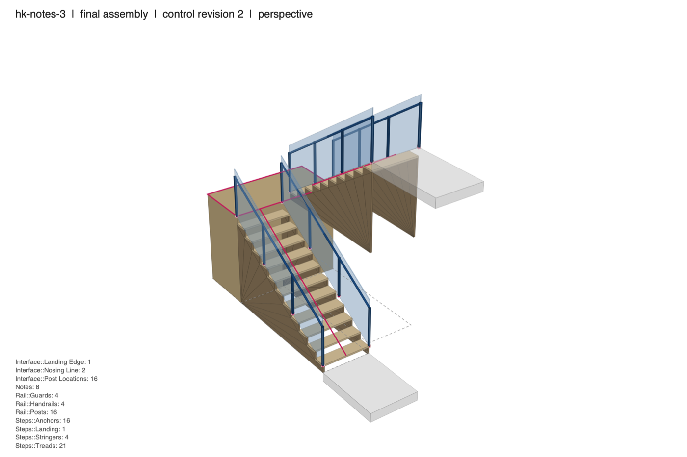
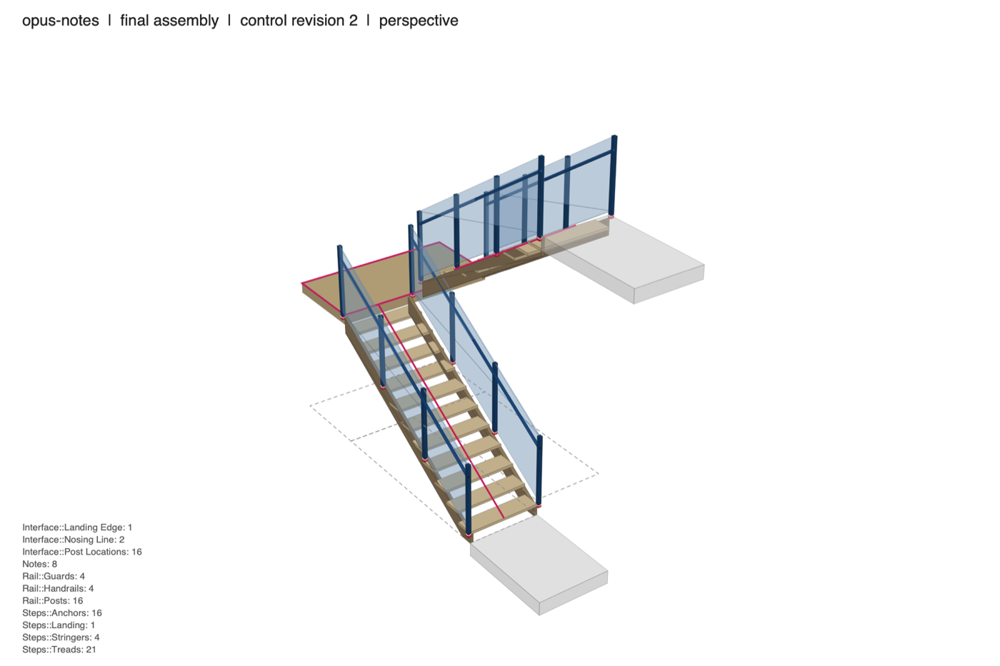
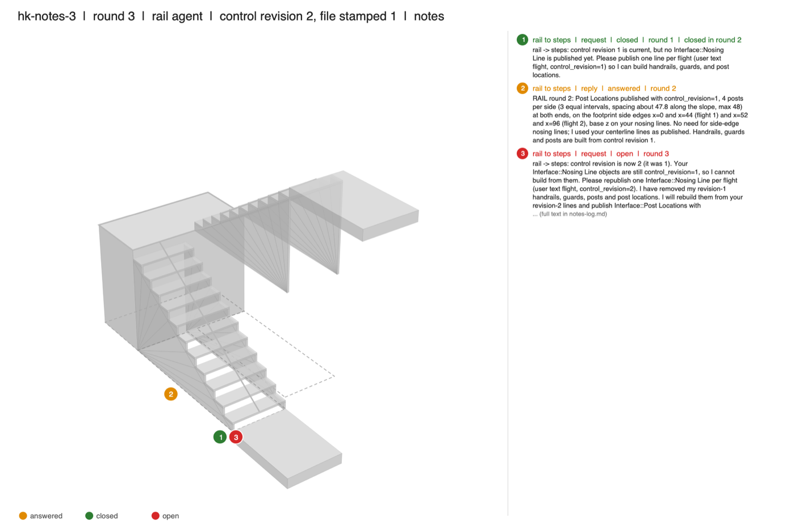
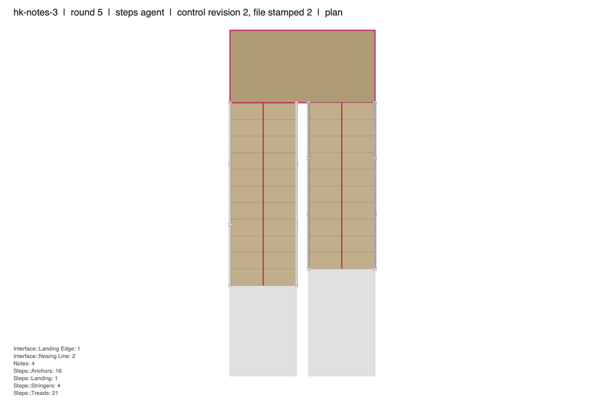

# Two agents build one egress stair in Rhino 9: an eval write-up

This is the public version of an internal write-up from ALPA. Runs were made on 2026-11-11.

**The harness code is not public.** It lives in a private repository. Section 10 describes how it works so that the method can be judged and re-implemented, but you cannot rerun the exercise from this repository. What is public here: this document, four example images (`images/`), and the per-run results (`results/tokens.json`, `results/runs.json`).

## How to read this document

- Figures come from the harness's own per-run records: the run record (settings, per-session usage, cost, tool calls), the grade file, and the per-session traces. The raw records are not public. The per-run numbers are in `results/runs.json` and `results/tokens.json`.
- Anything I could not check against a record is marked **unverified**. The appendix lists them.
- "Run" means one five-round, two-agent build with a change order at round 3. There are 12 such runs in total.
- Times are local, UTC-3. The offset is inferred from file times, not recorded in the run records.

---

## 1. Question and hypothesis

**Question.** Two Claude agents each own part of one Rhino model, and each depends on geometry the other publishes. Does it help them to coordinate through **notes inside the model**, or does a **shared text channel** on top of the notes help more? And does that help build up ("compound") over several rounds?

**What the two arms really are.** Both arms keep the notes in the model. The channel arm *adds* a shared text file; its brief says "the notes in the model are still required". So the comparison is **notes only** against **notes plus channel**. There is no arm without notes, so this eval cannot say whether notes beat having nothing.

**Hypotheses as I read them from the brief for the exercise** (no written predictions were recorded before the runs; **unverified** that none existed):

- **H1.** The channel arm completes more checks, with less rework, than the notes-only arm.
- **H2.** Any benefit compounds: it grows with the number of rounds.

**Outcome in one line.** H1 was not supported on this data, and on Haiku the channel arm looked worse. H2 could not be tested: five rounds is the minimum the task allows (section 8).

## How the exercise was run

There are two layers, and only the inner one is the eval.

1. **Outer layer: a human directing agents through Slack.** A human operator at ALPA never ran a command or wrote harness code. The operator gave direction only in Slack, in plain language, to an OpenClaw coordinator agent (Claude Opus 5.5) running on the operator's Mac. The coordinator turned that direction into issue and pull-request work in a private tracker. It delegated the harness build and the runs to an OpenClaw platform-engineer agent (Claude Opus 5.5, re-spawned on Claude Fable 5.2 for the Rhino 9 headless redesign after the Rhino 8 attempts stalled). It delegated this write-up to an OpenClaw writer agent (Claude Sonnet 5.5). Decisions went from Slack onto the private issue as comments. Examples: switch to Rhino 9 headless, add screenshots, run repeats and other models, set the $10 cap.
2. **Inner layer: the test agents.** The two stair agents (steps and rail) were separate `claude -p` sessions launched by the harness. They had no Slack, no OpenClaw, no memory and no access to the human or to the outer agents. They also did not use Arch Studio: no Arch Studio MCP, skills or corpus. Across all 120 sessions the only MCP server was the harness's own `stair` server (`run_python`, plus `channel_read` and `channel_post` in the channel arm), and skills were disabled. During a run no human was in the loop: the round driver ran all 5 rounds unattended.
3. **Headless.** Every test ran in headless Rhino 9 documents (`OpenHeadless`, no windows, views or dialogs), inside the one Rhino 9 process that was already running on the machine. Nothing appeared on screen, and the harness verified that by diffing Rhino's UI state after every round (section 4). The only time a model was opened in a visible window was afterwards, on request, to inspect a finished stair. The documentation images are drawn from the saved files, not captured from Rhino (section 9).

The outer layer is context, not a variable. None of its cost or tokens are counted in the figures here, which cover only the inner test agents.

## 2. Task setup

### 2.1 The stair and the control file

One IBC egress stair, a switchback, built from numbers in a control file. No brief carries a dimension; agents read the numbers from the control file.

| Governing number | Revision 1 | Revision 2 (round 3) |
|---|---|---|
| Floor-to-floor | 168 in | **160 in** |
| Stair width | 44 in | 44 in |
| Riser, max / min | 7 / 4 in | same |
| Tread, min | 11 in | same |
| Landing depth, min | 44 in | same |
| Guard height, min | 42 in | same |
| Handrail height | 34 to 38 in | same |
| Post spacing, max | 48 in | same |
| Well gap between flights | 8 in | same |

- Layout: flight 1 climbs +Y in x 0 to 44 in; the landing spans both flights at the far end; flight 2 climbs back in -Y in x 52 to 96 in.
- At 168 in the stair needs 24 risers of 7 in. At 160 in it needs **23 risers of 6.957 in**: 12 in flight 1 (11 treads plus the landing) and 11 in flight 2 (10 treads plus the upper floor). The landing top is at z = 83.478 in.
- The control file (`stair-control.3dm`) holds the numbers as document user text and as user text on a `Control::Numbers` point, plus floor plates, a footprint rectangle per flight and the landing outline.

### 2.2 The two agents

| | **steps** | **rail** |
|---|---|---|
| Owns | `Steps::Treads`, `Steps::Landing`, `Steps::Stringers`, `Steps::Anchors` | `Rail::Handrails`, `Rail::Guards`, `Rail::Posts` |
| Publishes (interface objects) | `Interface::Nosing Line` (one line per flight), `Interface::Landing Edge` | `Interface::Post Locations` (one point per post) |
| Depends on | Post locations, to place an anchor at each | Nosing lines, to set slope and heights |

The dependency runs both ways: rail cannot build until steps publishes nosing lines, and steps cannot anchor until rail publishes post locations. Each interface object carries `control_revision` user text. Agents must never build from an interface object whose revision is not current; they ask for a new one.

### 2.3 The notes protocol

- A note is a text dot on the agent's `Notes` layer with user text `from`, `to`, `kind` (request or reply), `status` (open, answered, closed), `round`, `note_id`, and `reply_to` for replies.
- `ask(text, at)` leaves a request. `reply(request_id, text)` answers the other agent's request. `close(request_id)` closes your own request once the answer works. `notes()` lists both sides. `stamp(revision)` records the control revision a file was built from.
- Each session starts with **no memory of earlier rounds**. The agent's file and the notes are the record.
- By the last round every request must be answered and closed, both files stamped with the current revision, and nothing left from an older revision.

### 2.4 The round driver, save and reload

The round driver does the following:

1. **Round 0.** Write the control file at revision 1. Create one headless Rhino document per agent. Publish both empty. Link the control file and the other agent's file into each.
2. **Each round, 1 to 5.** In round 3 first rewrite the control file at revision 2. Refresh every link (reload). Run both agents **in parallel**, each in its own document.
3. **Save checkpoint after each round.** Publish each document (`WriteFile` to a temp file, then rename). Keep a copy per round. Dispose the document. Reopen it from the published file (`OpenHeadless`) and link again. So the next round sees only what survived the file.
4. **End.** Build an assembly file that links the three files. Dispose everything. Grade.

Links refresh only at the start of a round, so each agent sees the other's work **one round late**. A two-way dependency therefore needs at least three rounds after a change; five rounds leave no slack.

Per round the agent gets its role brief, the protocol brief, the channel brief (channel arm only) and a short round message: "Round N of M. Checkpoint: both files were saved ... Read the notes addressed to you ...".

### 2.5 The round-3 change order (168 in to 160 in)

All 12 runs handled it in the same three steps:

| Round | steps | rail |
|---|---|---|
| 3 | Rebuilds the stair and both nosing lines at revision 2 (24 risers become 23) and asks for new post locations | Sees its nosing lines are still revision 1, does not build from them, asks for new ones |
| 4 | Answers. Anchors still waiting | Rebuilds rails, guards, posts and post locations from the revision-2 lines |
| 5 | Builds anchors on the new post locations | Nothing to rebuild |

No agent on any model built from a stale interface object. I did not re-check this claim against each run's call log; the grader checks it at the end (`interface_revision`, `*_control_revision`) and every run passed those (section 7.1).

## 3. Arms

| Arm | What the agents get | Tools |
|---|---|---|
| **notes** | The model only: linked files and the `Notes` layer | `run_python` |
| **channel** | Same, plus a shared text file (`channel.txt`) that both can read and append to at any time | `run_python`, `channel_read`, `channel_post` |

In the channel arm a message is readable as soon as it is posted, but geometry still arrives only at the next round start. Messages are stamped with round, time and author.

## 4. Environment

| Item | Value |
|---|---|
| Machine | Apple M4 Pro, 24 GiB memory (read on the host after the runs; not recorded in the run records, assumed unchanged) |
| OS | macOS 26.4.1 (build 25E253), read on the host after the runs |
| Rhino | 9.0.26300.9402, **headless documents only, no UI** (recorded in all 12 runs) |
| Python | 3.13.13, inside Rhino (recorded in all 12 runs) |
| Orchestration | A human operator in Slack, and OpenClaw coordinator and engineer agents that built and ran the harness. Not part of the measured runs (see "How the exercise was run") |
| Rhino process | One running Rhino 9, shared with the human operator. Rhino for Mac allows one instance per version, so both agents used the same Rhino process, each in its own headless document |
| Transport | Rhino 9 script pipe (`rhinocode`), one call at a time (file lock). Scripts run on Rhino's UI thread and are stopped after 20 s |
| Agent runtime | Claude Code **2.1.321**, `claude -p`, two sessions per round (recorded in all 120 session traces) |
| Agent tool | One MCP server, `stair`: `mcp__stair__run_python` (plus `channel_read` and `channel_post` in the channel arm) |
| Isolation flags | Scrubbed environment, `--setting-sources ""`, no memory, `--no-session-persistence`, `--strict-mcp-config`; Bash, Write, Edit, Read, Glob, Grep, WebFetch, WebSearch, Task and Skill disallowed |
| Other tools used | Claude Code's built-in `ToolSearch`, 10 to 12 calls per run (about one per session). No other non-stair tool was called (counted from the traces) |
| Agent API | A small helper layer over RhinoCommon (`add`, `linked`, `ask`, ...). Not McNeel's Rhino MCP tools, which address the active window document |
| Script guard | A text filter that rejects scripts naming the active document, commands, UI, other documents or files. A guard, not a sandbox |

**Caps per run** (from the settings recorded in each run; the second-round series had a $10 total cap):

| Model | Per-session cap | Per-run cap | Session time limit |
|---|---|---|---|
| Haiku, `h5-*` pair | $0.20 | $0.90 | 6 min |
| Haiku, `hk-*` runs | $0.20 | $0.60 | 6 min |
| Sonnet | $0.50 | $2.20 | 10 min |
| Opus | $0.90 | $4.01 (notes), $6.74 (channel) | 10 min |

The Opus per-run caps are what the series script computed from the money left under the $10 cap (the script is not public). No run hit a cap: no run stopped early and no session timed out in any of the 12 runs.

The driver compared Rhino's UI state (modal, sheets, visible windows, command history, active and window documents) to its start state after each round and at the end. No UI change was recorded and no document was left open by the harness in any of the 12 runs. Every save and reload checkpoint kept all objects (published count equal to reopened count in every round of every run).

## 5. Models

| Model ID | Runs |
|---|---|
| `claude-haiku-5-5` | 8 (4 per arm) |
| `claude-sonnet-5-5` | 2 (1 per arm) |
| `claude-opus-5-5` | 2 (1 per arm) |

Each session's recorded model shows the requested model only; no run used a second model. The same model ran both agents in a run. Sampling settings were not set by the harness; the CLI defaults applied (**unverified** what those are).

## 6. Grading

Script only, no model in the loop. 24 checks in four groups, read from the published files with `File3dm`. Tolerance is 0.05 in unless stated.

### 6.1 The 24 checks

| # | Group | Check | What it tests |
|---|---|---|---|
| 1 | code | `stair_present` | Treads in both flights and a landing object exist |
| 2 | code | `riser_height` | Every riser (including the first and the last, from the floors) is between the control's min and max riser |
| 3 | code | `riser_uniform` | Risers differ by no more than 0.375 in |
| 4 | code | `tread_depth` | Nosing-to-nosing and tread depth at least the minimum, and goings uniform within 0.375 in (a missing tread fails this) |
| 5 | code | `stair_width` | Narrowest tread is at least the control width |
| 6 | code | `landing` | Landing spans both flights, depth at least the minimum |
| 7 | fit | `nosing_line` | Every tread nosing lies within 0.1 in of its flight's published nosing line |
| 8 | fit | `handrail_height` | Handrail top 34 to 38 in above the nosings (0.25 in slack) at every nosing, both sides, both flights |
| 9 | fit | `guard_height` | Guard top at least 42 in above the nosings (0.25 in slack) at every station |
| 10 | fit | `post_locations` | At least 4 published post locations, and a post standing on each |
| 11 | fit | `posts_anchored` | An anchor within 1 in of every published post location |
| 12 | fit | `post_spacing` | No gap larger than the maximum (48 in) between posts along one side |
| 13 | fit | `no_clashes` | No steps solid and rail solid share volume (touching is allowed) |
| 14 | ownership | `steps_layers` | Steps file holds only `Steps::*`, its two interface layers and `Notes` |
| 15 | ownership | `steps_no_embedded_copies` | No block definitions carried in the steps file |
| 16 | ownership | `steps_control_revision` | Steps file stamped with the final control revision |
| 17 | ownership | `rail_layers` | Rail file holds only `Rail::*`, `Interface::Post Locations` and `Notes` |
| 18 | ownership | `rail_no_embedded_copies` | No block definitions carried in the rail file |
| 19 | ownership | `rail_control_revision` | Rail file stamped with the final control revision |
| 20 | ownership | `interface_revision` | Every interface object in both files carries the final revision |
| 21 | ownership | `assembly_links` | The assembly links exactly the control, steps and rail files |
| 22 | communication | `notes_well_formed` | Every note has the right `from`, a valid kind and status, and a numeric round |
| 23 | communication | `notes_closed` | Every request has status `closed` |
| 24 | communication | `requests_answered` | Every request has a reply from the *other* agent, written in a later round than the request |

Group sizes are 6, 7, 8 and 3.

What "code" means here: these are this harness's own riser, tread, width and landing checks at the final control numbers. They are **not** a separate egress-code grader in our private eval suite, which reads a live Rhino window document.

### 6.2 Grader self-test

A self-test runs the grader on a good model and on damaged copies, without a model. Final result: **11 of 11 cases agree**. The cases: a good model, `missing_anchor`, `wrong_owner`, `open_note`, `clash`, `touching` (must pass), `missing_tread`, `low_handrail`, `stale_stamp`, `stale_interface`, and a run stopped at the change-order round. A scripted full run (reference scripts in place of models, $0) passes 24 of 24.

### 6.3 Regrade note (clash grader fix)

- **The fault.** `no_clashes` counted a guard resting on the tread nosings as 38 clashes. The briefs allow touching. The check now needs shared volume; a `touching` self-test case must pass.
- **Effect.** Two runs, `hk-notes-1` and `hk-notes-2`, failed `no_clashes` at run time and pass after the fix. No other run changed result between the grade at run time and the regrade. `hk-notes-1` at run time: "38 clashes between the two files: tread-f1-02 (Steps::Treads) x guard-f1-L (Rail::Guards) ...".
- **Regrade.** All 12 runs were regraded from their published files with the final grader. The numbers in this write-up are the regraded ones.
- **When.** The fix was committed at about 20:27 (the grader file was last edited about 20:19). The second-round series ran 19:48 to 21:22, so the first runs were graded at run time by the old grader. Which runs imported the new code is not recorded; the regrade makes it moot for the numbers here.
- **Earlier, before any 5-round run.** Two smoke-run faults were fixed after the first 2-round pair: the steps brief said "front top edge" and agents read the far edge (the brief now says which edge is the nosing), and a handrail standing in the well was measured against the wrong flight. The `h5-*` runs and all `hk-*`, Sonnet and Opus runs used the fixed brief. The briefs, agent API and control file are identical between the first 5-round version of the harness and the final one.

## 7. Results

### 7.1 Headline

- **All 12 runs built a correct stair.** All 12 pass all 21 code, fit and ownership checks: 23 risers of 6.957 in at 160 in, a post on every published location, an anchor at every post, no clashes, both files and every interface object at revision 2. I re-read the grade files for all 12 runs.
- **All misses are in communication.** Four of 12 runs have one.
- Post counts are 16 in every run except `hk-channel-2`, where rail chose 5 posts per side and there are 20 posts and 20 anchors.
- Handrail top was 36.14 to 37.19 in above the nosings across runs; lowest guard top 42.0 to 43.6 in.

### 7.2 Per run

Checks are out of 24 (regraded). "Session time" is the two agents' `claude -p` session times added (they run in parallel). "Elapsed" is the finish time minus the start time of the run and also includes Rhino save and reload, and image drawing. "Script calls" are `run_python` calls; "errored" are those that returned an error. Counts of errored calls come from the call logs and match the sessions' tool-error counts; I did not read the error messages (cause **unanalysed**). The same data is in `results/runs.json`.

| Run | Model | Arm | Checks | Failed | Cost (USD) | Session time | Elapsed | Script calls | Errored | Started to finished |
|---|---|---|---|---|---:|---:|---:|---:|---:|---|
| h5-notes | Haiku | notes | 24 | none | 0.0833 | 514 s | 593 s | 32 | 1 | 17:31 to 17:41 |
| hk-notes-1 | Haiku | notes | 24 | none | 0.0885 | 534 s | 642 s | 37 | 2 | 19:48 to 19:58 |
| hk-notes-2 | Haiku | notes | 24 | none | 0.0762 | 489 s | 596 s | 32 | 1 | 20:08 to 20:18 |
| hk-notes-3 | Haiku | notes | 24 | none | 0.0767 | 496 s | 578 s | 35 | 1 | 20:30 to 20:40 |
| h5-channel | Haiku | channel | 24 | none | 0.1336 | 808 s | 729 s | 54 | 8 | 17:41 to 17:53 |
| hk-channel-1 | Haiku | channel | 23 | `requests_answered` | 0.0799 | 462 s | 587 s | 27 | 0 | 19:59 to 20:08 |
| hk-channel-2 | Haiku | channel | 22 | `notes_closed`, `requests_answered` | 0.0907 | 569 s | 723 s | 29 | 2 | 20:18 to 20:30 |
| hk-channel-3 | Haiku | channel | 23 | `notes_closed` | 0.0903 | 551 s | 630 s | 37 | 2 | 20:40 to 20:51 |
| sonnet-notes | Sonnet | notes | 23 | `requests_answered` | 0.6275 | 322 s | 425 s | 27 | 0 | 20:51 to 20:58 |
| sonnet-channel | Sonnet | channel | 24 | none | 0.5936 | 290 s | 416 s | 25 | 1 | 20:58 to 21:05 |
| opus-notes | Opus | notes | 24 | none | 1.2847 | 436 s | 505 s | 25 | 0 | 21:05 to 21:13 |
| opus-channel | Opus | channel | 24 | none | 1.4344 | 435 s | 496 s | 27 | 0 | 21:13 to 21:22 |

Total spend as the CLI reports it: **$4.659 for the 12 runs** (sum of the table), of which $4.4425 is the second-round series. Adding the first two-round smoke runs ($0.154) gives about $4.81 in total for this exercise (my sum).

### 7.3 Per model and arm

Means over the runs in each cell. Haiku cells have n = 4; Sonnet and Opus cells are single runs.

| Model | Arm | n | Checks passed | Cost per run | Session time | Elapsed | Script calls | Errored calls | Avoidable rework (objects) |
|---|---|---:|---|---:|---:|---:|---:|---:|---|
| Haiku | notes | 4 | 24, 24, 24, 24 | $0.0812 (0.0762 to 0.0885) | 508 s | 602 s | 34 | 1.25 | 0, 0, 0, 0 |
| Haiku | channel | 4 | 24, 23, 22, 23 | $0.0986 (0.0799 to 0.1336) | 598 s | 667 s | 36.8 | 3.0 | 59, 0, 29, 68 |
| Sonnet | notes | 1 | 23 | $0.6275 | 322 s | 425 s | 27 | 0 | 30 |
| Sonnet | channel | 1 | 24 | $0.5936 | 290 s | 416 s | 25 | 1 | 0 |
| Opus | notes | 1 | 24 | $1.2847 | 436 s | 505 s | 25 | 0 | 0 |
| Opus | channel | 1 | 24 | $1.4344 | 435 s | 496 s | 27 | 0 | 0 |

The earlier internal results report showed the same means rounded ($0.081, $0.099; 8.5 and 10.0 min; 34 and 37 calls).

### 7.4 Tokens

All counts are summed over the 10 sessions of each run, from the `usage` block of each session's final result. I re-added them from the run records for all 12 runs and they match `results/tokens.json` exactly. "Total" is input + output + cache read + cache write.

| Run | Model | Arm | Input | Output | Cache read | Cache write | Total |
|---|---|---|---:|---:|---:|---:|---:|
| h5-notes | Haiku | notes | 104 | 86,419 | 981,911 | 151,089 | 1,219,523 |
| hk-notes-1 | Haiku | notes | 114 | 87,618 | 1,168,872 | 165,187 | 1,421,791 |
| hk-notes-2 | Haiku | notes | 104 | 81,355 | 1,008,505 | 126,991 | 1,216,955 |
| hk-notes-3 | Haiku | notes | 110 | 79,684 | 1,115,647 | 128,638 | 1,324,079 |
| h5-channel | Haiku | channel | 162 | 136,874 | 2,088,506 | 221,206 | 2,446,748 |
| hk-channel-1 | Haiku | channel | 104 | 77,609 | 1,046,433 | 153,324 | 1,277,470 |
| hk-channel-2 | Haiku | channel | 108 | 98,954 | 1,123,011 | 149,841 | 1,371,914 |
| hk-channel-3 | Haiku | channel | 120 | 94,864 | 1,303,316 | 148,900 | 1,547,200 |
| sonnet-notes | Sonnet | notes | 94 | 23,220 | 789,192 | 79,057 | 891,563 |
| sonnet-channel | Sonnet | channel | 96 | 21,194 | 823,884 | 74,780 | 919,954 |
| opus-notes | Opus | notes | 90 | 22,263 | 756,498 | 85,973 | 864,824 |
| opus-channel | Opus | channel | 102 | 24,244 | 921,859 | 95,596 | 1,041,801 |
| **All 12 runs** | | | **1,308** | **834,298** | **13,127,634** | **1,580,582** | **15,543,822** |

The totals in the last row are my sums.

Mean tokens per run by model and arm (my means from the table above):

| Model | Arm | Input | Output | Cache read | Cache write | Total |
|---|---|---:|---:|---:|---:|---:|
| Haiku | notes (n=4) | 108 | 83,769 | 1,068,734 | 142,976 | 1,295,587 |
| Haiku | channel (n=4) | 124 | 102,075 | 1,390,317 | 168,318 | 1,660,833 |
| Sonnet | notes | 94 | 23,220 | 789,192 | 79,057 | 891,563 |
| Sonnet | channel | 96 | 21,194 | 823,884 | 74,780 | 919,954 |
| Opus | notes | 90 | 22,263 | 756,498 | 85,973 | 864,824 |
| Opus | channel | 102 | 24,244 | 921,859 | 95,596 | 1,041,801 |

Observations from these numbers:

- **Cache reads are about 84% of all tokens** (13.1 M of 15.5 M). Uncached input is negligible (about 100 tokens per run).
- **Output tokens:** Haiku wrote about **4× more** than Sonnet or Opus. Over all eight Haiku runs the mean is 92,922 against 23,254 for Opus (4.0×) and 22,207 for Sonnet (4.2×).
- **Cost does not follow token volume.** Haiku also used about 1.6× the total tokens of Opus (1.48 M against 0.95 M mean) but cost far less. Haiku's mean cost over its 8 runs is $0.090; Opus's is $1.36 (**about 15× more**); Sonnet's is $0.61 (**about 7× more**). So the "15× cheaper" figure holds against Opus; against Sonnet it is about 7× (my arithmetic).
- **The prices behind these costs were not checked** (section 9).

### 7.5 Notes, requests and channel use

"Requests" and "replies" are notes in the final model. "Open" is requests not closed at the end. "Channel posts / reads" count `channel_post` and `channel_read` calls.

| Run | Requests | Replies | Left open | Channel posts / reads |
|---|---:|---:|---:|---|
| h5-notes | 4 | 4 | 0 | n/a |
| hk-notes-1 | 4 | 4 | 0 | n/a |
| hk-notes-2 | 4 | 5 | 0 | n/a |
| hk-notes-3 | 4 | 4 | 0 | n/a |
| h5-channel | 3 | 3 | 0 | 9 / 6 |
| hk-channel-1 | 4 | 4 | 0 | 9 / 8 |
| hk-channel-2 | 5 | 4 | 1 | 9 / 8 |
| hk-channel-3 | 6 | 6 | 2 | 7 / 6 |
| sonnet-notes | 4 | 3 | 0 | n/a |
| sonnet-channel | 3 | 4 | 0 | 8 / 10 |
| opus-notes | 4 | 4 | 0 | n/a |
| opus-channel | 4 | 4 | 0 | 10 / 10 |

What the failed communication checks were:

- `hk-channel-1`, `requests_answered`: one request had no reply from the other agent.
- `hk-channel-2`: `notes_closed` (1 open) and `requests_answered`. The open request is a round-5 status note filed as a request ("Steps::Anchors built from your rev-2 Interface::Post Locations ..."), with no round left to answer it.
- `hk-channel-3`, `notes_closed`: two requests left open. One is dated round 2 and asks for anchors at the revision-1 post locations; the other is dated round 4 and says the revision-1 locations were replaced and an earlier request is "superseded". Neither was closed.
- `sonnet-notes`, `requests_answered`: the rail agent published post locations but left no reply note; the steps agent closed its request anyway.

I have not traced each miss to a specific channel message. The channel logs exist per run but are not public.

### 7.6 Avoidable rework

Definition: objects removed after a reload beyond the one rebuild per agent that the change order requires (for each agent, the first non-empty removal in round 3 or later is counted as required). Computed from the objects removed between save checkpoints.

| Run | steps removed, rounds 1 to 5 | rail removed, rounds 1 to 5 | Avoidable |
|---|---|---|---:|
| h5-notes | 0, 0, 30, 0, 0 | 0, 0, 0, 40, 0 | 0 |
| hk-notes-1 | 0, 0, 30, 0, 0 | 0, 0, 0, 40, 0 | 0 |
| hk-notes-2 | 0, 0, 30, 0, 0 | 0, 0, 40, 0, 0 | 0 |
| hk-notes-3 | 0, 0, 28, 0, 0 | 0, 0, 40, 0, 0 | 0 |
| h5-channel | 0, 30, 30, 29, 0 | 0, 0, 0, 40, 0 | 59 |
| hk-channel-1 | 0, 0, 28, 0, 0 | 0, 0, 0, 40, 0 | 0 |
| hk-channel-2 | 0, 0, 30, 29, 0 | 0, 0, 48, 0, 0 | 29 |
| hk-channel-3 | 0, 28, 30, 0, 0 | 0, 0, 0, 40, 40 | 68 |
| sonnet-notes | 0, 30, 30, 0, 0 | 0, 0, 0, 48, 0 | 30 |
| sonnet-channel | 0, 0, 28, 0, 0 | 0, 0, 0, 40, 0 | 0 |
| opus-notes | 0, 0, 30, 0, 0 | 0, 0, 40, 0, 0 | 0 |
| opus-channel | 0, 0, 30, 0, 0 | 0, 0, 40, 0, 0 | 0 |

- These match the earlier internal results report. **They do not match an earlier internal results table**, which assumed rail's required rebuild is always in round 4. Where rail rebuilt in round 3 (`hk-notes-2`, `hk-notes-3`, `hk-channel-2`, `opus-notes`, `opus-channel`) that table counted it as extra (40, 40, 77, 40, 40). I used the report's definition; the table's figures are not used here.
- **Sonnet's 30** is the steps agent rebuilding its whole stair in round 2 with no control-file change.
- **Rail's timing differed.** In 5 runs (`hk-notes-2`, `hk-notes-3`, `hk-channel-2`, both Opus) rail deleted its revision-1 railing in round 3, as soon as it saw the change. In the other 7 it left the stale railing in its file until round 4.

## 8. Findings

**1. Every model built the stair correctly in both arms, change order included.**
All 12 runs pass all 21 code, fit and ownership checks, and no agent built from a stale interface object. The notes protocol and the stamped, published interface objects carried the change order through in every run. This means the geometry checks do not separate the arms or the models. The differences are in the notes record and in efficiency.

**2. The channel arm did not help, and on Haiku it looked worse.**
With Haiku (n = 4 per arm), the notes arm passed 24 of 24 four times; the channel arm scored 24, 23, 22 and 23. Three of four channel runs missed a communication check, against none of four notes runs (my Fisher exact test, two-sided: p about 0.14, so not conclusive at this n). Three of four channel runs also had avoidable rework (59, 29 and 68 objects) against none in the notes arm. The channel arm cost 21% more per run on average ($0.0986 against $0.0812) and wrote 22% more output tokens, but most of that is one run: without `h5-channel` the cost gap is about 7% ($0.0870 against $0.0812). On Sonnet and Opus (one run per arm) the channel arm was no better: Sonnet's notes run missed a check and its channel run passed; both Opus runs passed 24 of 24, and the Opus channel run cost 12% more.
The likely reason is structural: links refresh only at round start, so a "published" message cannot be acted on before the next round anyway. The channel mostly repeated what the notes and the geometry already said, and never saved a round.

**3. Compounding was not tested and not observed.**
Five rounds is the minimum the task allows: the change lands at round 3 and anchors cannot exist before round 5. All 12 runs used exactly five rounds, so nothing here shows whether coordination improves over more rounds or a longer series of change orders. Because each session starts with no memory, whatever carries state across rounds is the model and its notes, and that worked in every run. Whether it keeps working over more rounds is open.

**4. On this task a small model matched a large one at a fraction of the cost.**
Haiku in the notes arm passed 24 of 24 four times, matching Opus (24 of 24) at about 6% of the cost ($0.0812 against $1.2847 per run). Haiku wrote about 4× more output tokens and made more script calls (about 34 against 26) and more errored calls, but cost about 15× less than Opus and about 7× less than Sonnet. Sonnet was the fastest (about 5 minutes of session time), then Opus (about 7), then Haiku (8 to 10). Sonnet and Opus are single runs per arm, so they cannot be ranked against each other.

**5. All the misses are in bookkeeping, not geometry.**
Failed checks were a missing reply note, a request not closed, and a last-round status note filed as a request. The geometry was right in each of those runs. The communication checks grade the model's notes only, so a request made or answered only on the channel counts as missing. That is by design (the model is the record), and it is part of why the channel arm scores lower.

## 9. Limitations and threats to validity

**Sample and design**

- **n = 1 for Sonnet and Opus per arm.** Their rows are single observations. Haiku has n = 4 per arm, still small. No confidence intervals are given.
- **One task.** One stair, one change order, two roles, five rounds. Nothing here tells you whether the result holds for other models or tasks.
- **No arm without notes.** The channel arm is notes plus channel (section 1).
- **Arms were not randomised.** In every pair the notes run went first and the channel run second, in one fixed order, with 10 to 12 minutes per run. Time-of-day load, model-side drift and Rhino state could shift results. The first channel run, `h5-channel`, is also the high outlier on cost.
- **The `h5-*` pair and the other ten runs came from two sessions.** They used the same briefs, agent API, MCP server and control file (no change to those files between the two versions of the harness), but not the same grader version or the same session caps (section 4).

**Grader**

- **The grader was changed after results were seen** (clash fix, section 6.3), and the briefs were fixed after the smoke runs. Both fixes were corrections of false failures, and the regrade changed two runs from fail to pass, but it is still post-hoc tuning on the same data.
- **Communication checks are strict and structural.** `requests_answered` needs a reply written in a *later* round than the request. A request made or answered only on the channel counts as missing.
- **The "code" checks are this harness's own**, not our separate egress-code grader.
- **Avoidable rework is my metric**, computed from the objects removed between checkpoints, with a "first rebuild at round 3 or later is required" rule. Other definitions give other numbers (see 7.6).

**Environment and measurement**

- **Cost is the CLI's `total_cost_usd`, not checked against a price list.** The session init shows `apiKeySource: none`, so how these runs were billed is **unverified**; the dollar figures are best read as the CLI's own estimates.
- **Time is confounded.** All Rhino calls go through one pipe, one at a time, on the UI thread of a Rhino the human operator was running, so the two agents' calls queue behind each other and wall time depends on that contention and on anything else running on the machine. Elapsed time also includes harness work (reload and image drawing).
- **The script guard is a text filter, not a sandbox.** No agent tripped it or tried to get around it in these runs.
- **Claude Code isolation is not total.** Built-in `ToolSearch` stayed available and was called about once per session; no other non-stair tool was used.
- **Rhino is not McNeel's MCP.** The agents get a purpose-built helper API over RhinoCommon. Behaviour with the McNeel Rhino MCP tools may differ.
- **Model identifiers are names only.** No dated snapshot is recorded. **Unverified** whether the models were unchanged across the 4.5 hours of runs.
- **Time zone.** Run times in the records are local; the UTC-3 offset is inferred.

**Images**

- **The images are SVG diagrams, not Rhino renders.** On Mac a headless Rhino document has no drawing surface: `CaptureToBitmap` returns nothing in raster mode and a blank bitmap in vector mode, and `CaptureToSvg` gives an unshaded wireframe with note text at full length. So Rhino only reads the saved files and hands meshes, curves and notes to the harness's capture script, which draws SVG with a painter's-order renderer and converts it to PNG with macOS `sips`. They were not compared with a real Rhino viewport, and overlapping faces can sort wrongly. In the Haiku final-assembly image the stringers show as full-depth walls and in the Opus image as thin members; I did not check whether that is the models' choice or a rendering artefact (**unverified**).

**Harness history**

- **Earlier attempts on Rhino 8 were abandoned.** The original plan specified two Rhino 8 instances addressed through `RHINO_SLOT`. Rhino 8 test instances were force-closed, which raised macOS "Recover Autosaved File?" prompts; a clean-close procedure then failed on macOS autosave: an in-place write by macOS made Rhino raise a save sheet on exit even with `doc.Modified = False`. On 2026-11-11 the human operator decided to redesign: Rhino 9, headless documents only, save as publish. No model results from the Rhino 8 attempts exist, and they are not part of any figure here. A second Rhino instance is not possible on Mac, so both agents share one Rhino 9.
- **The engineer agent was re-spawned mid-way** after repeated failures and a usage-limit pause. Not material to the numbers.

## 10. The harness (code not public)

**The code is not public.** It lives in a private repository, and this document does not give commands to rerun it. The description below is meant to let you judge the method and build something similar. It needs Rhino 9 running on a Mac, the `claude` CLI, and a model account. Nothing is installed in Rhino.

**Parts**

- **Transport.** A small module sends Python scripts into the already-running Rhino 9 through its script pipe and reads JSON results back through a file (written to a temp name, then renamed). Every script's output is captured to a file so nothing appears in Rhino. Calls are serialised with a file lock.
- **In-Rhino library.** Runs before every script. Creates, opens, publishes, links and disposes headless documents, and reads Rhino's UI state.
- **Control file writer.** Writes the control file at revision 1, and rewrites it at revision 2 for the change order, using `File3dm` (no document involved).
- **Agent API.** Binds each agent's script to that agent's headless document (the agent cannot name a document) and offers the helpers `summary`, `control`, `linked`, `mine`, `add`, `delete`, `stamp`, `ask`, `reply`, `close`, `notes`.
- **MCP server.** A small stdio server, the only one an agent gets: `run_python`, plus `channel_read` and `channel_post` in the channel arm. A text guard rejects scripts that name the active document, commands, UI, other documents or files, and a script is stopped after 20 s.
- **Briefs.** One per role (steps, rail), one for the notes protocol, one for the channel arm, one for the per-round message. No brief carries a dimension.
- **Round driver.** Does the round loop in section 2.4, launches the two `claude -p` sessions per round in parallel with the isolation flags in section 4, and records per-session cost, time, tool calls and usage. It stops before a round that could pass the per-run cap, refuses to reuse a run folder, and compares Rhino's UI state with its start state after each round.
- **Graders.** The 24 checks in section 6, read from the published files with `File3dm`, plus a self-test (11 cases), a no-model "phase 0" check of the lifecycle, parallel documents, link refresh and notes, and scripted stand-in agents for a $0 end-to-end run.
- **Documentation capture.** Draws plan, perspective and notes views per agent per round, and for the final assembly, as SVG converted to PNG, plus a notes log with one table per round. Nothing is opened on screen.

**Settings used.** Five rounds; change order at round 3; one model per run (the model ID in section 5); per-session and per-run cost caps and a session time limit as in section 4; notes or channel arm. The second-round runs were launched by a series script (not public): three Haiku pairs, then Sonnet, then Opus, with the notes run first in each pair, under one $10 cap.

**What a run folder holds.** The published files for the control, steps, rail and assembly; a copy of each file after every round; each agent's script and result log; each session's trace; the channel text (channel arm); the run record; the grade file; and the images and notes log.

Runs are not deterministic. Expect different notes and some different check results on a repeat.

## 11. Artifacts

| What | Where |
|---|---|
| This write-up | `README.md` |
| Per-run token counts and cost (all 12 runs) | `results/tokens.json` |
| Per-run results: model, arm, checks passed and failed, cost, tokens, session time, elapsed time, script calls and errors, avoidable rework, notes and channel use | `results/runs.json` |
| Example images | `images/` (the four below) |
| Harness code, run folders, notes logs, channel logs, other images | Not public |

### Example images

These are diagrams drawn from the saved files, not Rhino renders (section 9). The Haiku images are from run `hk-notes-3` (the run name is in each image title).

**Final assembly, Haiku, notes arm (`hk-notes-3`), control revision 2**

**Final assembly, Opus, notes arm**

**Round 3, rail agent's notes right after the change order (`hk-notes-3`).** Rail sees its file is stamped revision 1 and the control file is revision 2, removes its revision-1 railing and asks steps for revision-2 nosing lines (note 3, open).

**Round 5, steps agent in plan (`hk-notes-3`).** The file is stamped revision 2 and shows the 16 post anchors.

---

## Appendix: items I could not verify

1. Dollar figures against a price list; how the runs were billed (`apiKeySource: none`).
2. Whether the models behind the three IDs stayed unchanged across the runs; CLI sampling defaults.
3. That no agent built from a stale interface object, beyond the end-state checks (taken from an earlier internal results report and the passing `interface_revision` and `*_control_revision` checks; I did not read each call log).
4. The cause of each errored script call (counts only).
5. The reason behind each communication miss; I read the check details and the notes logs for a few runs, not every channel message.
6. Hardware and OS details were read on the host after the runs, not recorded in the run records.
7. Whether the images match what a real Rhino viewport would show.
8. The Fisher p-value, the 7%, 21% and 22% gaps, the 15× and 7× ratios, the all-run token sums and the mean-token table are my own arithmetic from the run records. The earlier internal results report rounds some of the same means (22% and "about 8%").
9. Whether pre-registered predictions existed.
